# Minelization 로드맵 (설계 v0.3)

2026-10-16 사용자 요구사항을 반영해 [DESIGN.md](DESIGN.md)의 MVP 위에 쌓을 큰 방향을 정리한다. 지금 코드는 "청크 단위 추상 시뮬레이션" MVP이고, 아래는 그것을 **월드박스식 개체(주민) 기반 시뮬레이션**으로 키우는 계획이다.

---

## 0. 원칙: "그대로 가져오기"의 범위

| 가져온다 | 가져오지 않는다 |
| --- | --- |
| 월드박스·문명·하츠 오브 아이언의 **규칙과 시스템** (주민 이동, 집 짓기, 통치자 계승, 외교, 전선·보급 등) | 그 게임들의 **코드, 이미지, 소리, 문구** |
| 공개 위키, 실제 플레이 관찰, 공개 개발 자료에서 알아낸 동작 | 디컴파일한 바이너리 (해당 EULA가 금지하고, 공개 GitHub에 올리면 저작권 침해) |

게임 규칙과 메커니즘 자체는 저작권 대상이 아니다. 동작은 똑같이 재현하되, 구현은 이 프로젝트에서 새로 쓴다. 월드박스 파일을 주더라도 **코드를 읽어 옮기지는 않는다.** 대신 실행 화면, 설정 파일의 수치처럼 플레이로 관찰할 수 있는 정보는 참고할 수 있다.

외부 모드도 같은 기준이다.

| 대상 | 라이선스 | 쓰는 법 |
| --- | --- | --- |
| Chunky (미리 생성) | GPL-3.0 | 우리 jar에 넣지 않는다. 설치돼 있으면 `chunky` 명령을 서버 명령으로 호출 (코드 링크 없음) |
| ServerCore (서버 최적화) | MIT + 일부 GPL | 함께 설치를 권장하는 동반 모드. 코드 복사 없음 |
| Xaero's World Map | 저작권 보유 (비공개) | 화면 구성만 참고, 직접 구현 |
| uNmINeD | 비공개 | 지형 음영 방식만 참고, 직접 구현 |

---

## 1. 가장 중요한 것: 주민 6000명 이상을 부하 없이

### 1.1 문제

바닐라 주민은 몹 중에서도 가장 무겁다. 매 틱 돌아가는 Brain(감각기·기억·행동)과 경로탐색이 비용의 대부분이고, 서버 운영 쪽에서 쓰는 처방은 전부 "AI를 덜 돌리기"다.

- Pufferfish DAB: 플레이어에게서 멀수록 주민 Brain을 드물게 틱
- Paper/ServerCore Activation Range: 먼 엔티티의 틱을 건너뜀
- "Lobotomize": 경로탐색 AI를 아예 제거

6000명을 진짜 `Villager` 엔티티로 두면 이 처방을 다 써도 버티기 어렵다. 엔티티 하나하나가 추적·충돌·패킷 비용을 낸다 (courierpost 측정: 닭 1000마리만 띄워도 TPS 20 → 4.45).

### 1.2 해법: 개체 LOD (3단계)

주민을 **엔티티가 아니라 데이터**로 둔다. 화면에 보일 필요가 있을 때만 몸을 만든다.

| 단계 | 대상 | 표현 | 서버 비용 |
| --- | --- | --- | --- |
| L0 데이터 | 전원 (수천~수만) | 배열에 담긴 위치·집·직업·상태·소속. 1초에 1번(멀면 더 드물게) 갱신. 경로는 마을 도로 그래프 위 노드 이동 | 거의 0 (배열 순회) |
| L1 표시 | 플레이어 48블록 안, 1인당 최대 약 150명 | **엔티티 없이 패킷만**으로 보여준다. 모드 클라이언트는 우리 패킷을 받아 클라이언트 전용 모델로 그리고, 바닐라 클라이언트에는 가짜 엔티티 생성·이동 패킷을 보낸다. 서버에는 Entity 객체가 없다 | 패킷 전송뿐 |
| L2 실체 | 플레이어가 직접 상호작용하거나 전투에 휘말린 소수 | 진짜 `Villager` 엔티티. 단, 바닐라 Brain 대신 가벼운 전용 행동 | 일반 엔티티 |

- L0의 이동은 월드박스처럼 "목적지(밭, 광산, 집, 시장) → 도로 노드 따라 걷기"로 단순화한다. 블록 단위 A* 탐색은 하지 않는다.
- 인구 숫자 = L0 개체 수. 인구가 늘면 개체를 추가하고, 죽으면 제거한다.
- 측정 목표: 개체 20,000명 + 플레이어 10명에서 TPS 19.5 이상, 시뮬레이션 틱 2ms 이하. 벤치마크를 테스트로 만들어 회귀를 막는다.
- 동반 설치 권장: ServerCore, Lithium (L2와 일반 몹에 효과).

### 1.3 A단계 결과 (2026-10-16 구현·측정)

L0 + L1 구현 완료. L2(실체)는 B단계에서 상호작용이 생길 때 붙인다.

- **L0** `sim/Agents.kt`: 위치·목표·집·속도·타이머·소속·직업·상태를 배열로 저장한다. 빈 슬롯을 재사용해서 인덱스가 바뀌지 않는다. 먼 개체는 20틱에 한 번(1/20씩 나눠서), 표시 중인 개체는 2틱에 한 번 걷는다. 매 턴 인구에 맞춰 개체 수를 맞추고, 집이 남의 땅이 되면 그 나라 사람이 된다 (정복 시 주민 귀속).
- **L1** `mc/AgentDisplay.kt`: 플레이어 48블록 안 가까운 150명을 바닐라 엔티티 패킷(생성·위치 동기화·머리 회전·제거)으로만 보여준다. 서버에는 Entity 객체가 없다. 바이옴별 주민 외형과 직업복(농부 모자 등)을 템플릿 주민 1개에서 복사한 데이터로 입힌다. 바닐라 클라이언트에서도 보인다.

**실측** (26.3 전용 서버, 플레이어 1명이 가장 붐비는 수도 위)

| 조건 | 서버 MSPT | TPS |
| --- | --- | --- |
| 개체 0 | 2.3 ms | 20 |
| 개체 20,000 (표시 150) | 2.3 ms | 20 |
| 개체 100,000 (표시 150) | 2.3 ms | 20 |
| 비교: 바닐라 주민 1,000 | 42 ms | 20 (한계 직전) |
| 비교: 바닐라 주민 2,000 | 94 ms | 10.5 |

- 개체 처리 시간: 20,000명에서 평균 0.03~0.5 ms/틱, 100,000명에서 최대 1.6 ms/틱 (격자 재구성 틱)
- 단위 테스트 벤치마크: 20,000명 L0만 0.015 ms/틱, 인구 동기화 1.4 ms/턴
- 네트워크: 플레이어 1명당 초당 패킷 1,500~2,600개, 약 34~58 KB/초

**아직 확인하지 못한 것 / 남은 문제**

- 플레이어 10명 동시 접속은 측정하지 못했다 (개발 클라이언트가 1개뿐). 플레이어당 표시 비용은 0.5 ms/틱 안팎이므로 10명이면 약 5 ms/틱 이하로 추정한다. 실측이 필요하다.
- 걷는 길이 직선이라 물 위나 얼음 위를 걷기도 하고, 집의 1/3이 수도 청크에 몰려 뭉쳐 보인다. B단계에서 도로 그래프와 실제 집 건물로 바꾼다.
- 표시된 주민을 클릭해도 아무 일이 없다 (서버에 실체가 없음). L2에서 해결한다.
- 대역폭을 더 줄이려면 멀리 있는 표시 개체의 갱신 주기를 늘린다.

---

## 1.4 자연스러운 주민 행동 (2026-10-17)

사용자 요구: 순간이동 같은 부자연스러운 행동 금지, 행동 패턴은 MineColonies 참고. MineColonies(GPL-3.0)의 코드는 쓰지 않고 시민 생활 방식(집·직장·일과·비 피하기)만 참고했다.

- **일과**: 새벽(23300~1000) 집 근처 → 낮(1000~10500) 직업 건물로 출근해 일 → 저녁(10500~12500) 모임 장소(신전·시장, 없으면 수도)에서 어울림 → 밤과 비 오는 날 귀가. 집이 실제 주택이면 문 앞에서 집 안으로 들어가 보이지 않게 되고(취침) 아침에 다시 나온다. 주택 1채당 5명.
- **직업 건물**: 농부→농장, 나무꾼→벌목장, 광부→광산·채석장, 상인→시장, 학자→도서관·신전, 병사→병영·성벽. 건물이 없으면 집 근처를 돌아다닌다. 아이는 모임 장소 근처에서 논다.
- **길찾기**: 플레이어 근처(표시 중)인 주민만 블록 단위 A*로 걷는다 (8방향, 1칸 오르기·3칸 내려가기, 2칸 높이 공간, 물·용암 회피, 문은 통과, 울타리·담 위는 못 섬, 지붕 위는 비용 가산). 경로는 직선 구간을 합쳐 단순화. 갈 수 없으면 가장 가까운 지점까지만 간다.
- **순간이동 방지**: 보이기 시작하는 순간 주변 9×9에서 땅 높이를 추정해 바닥(지붕·동굴 아님)에 먼저 올려놓고 나서 보여준다. 새로 태어나는 주민은 플레이어 시야 밖에서 생겨 걸어 들어오고, 인구가 줄 때는 보이는 주민을 지우지 않는다.
- **겉모습**: 직업별 도구를 든다(괭이·도끼·곡괭이·삽·에메랄드·책·검). 일할 때 고개를 숙인다. 걷는 방향을 본다.
- **부하 분산**: 보이기 시작할 때 자리 잡기는 2틱에 25명까지, 경로 탐색은 틱당 6회까지.

실측 (개체 20,000, 정글 지형, 해 뜰 때 150명이 한꺼번에 보이기 시작하는 상황 포함): **순간이동 0건** (보이는 주민이 2틱 사이에 1.2블록 넘게 움직이면 기록), 경로 탐색 평균 0.27ms, 개체 처리 최대 2ms/틱, MSPT 1.7~2.1.

## 1.5 작업 지정 모드 (2026-10-17, B단계 첫 부분)

사용자 요구로 **건물 자동 건설은 폐지**하고, 모든 건설·철거를 "작업 지시"로 한다. AI 나라도 같은 작업 지시 체계를 쓴다 (AI가 자리를 골라 지시를 낼 뿐, 실제 공사는 인부가 한다).

| 기능 | 내용 |
| --- | --- |
| 작업 지정 모드 | 관전자 모드 전용. `B`로 켠다. 좌클릭 드래그로 영역, `C` 도구(선택·건축·성벽·철거·평탄화), `Z/X` 건물 종류, `R` 회전, `V` 징용, `Enter`/우클릭 지시 |
| 건축 | 바닐라 마을 구조물 템플릿(평원·사막·사바나·타이가·설원 126종)을 바이옴에 맞게. 기초 흙 채우기 → 아래층부터 한 블록씩 |
| 성벽 | 드래그한 영역 둘레에 석재 벽돌 성벽 |
| 철거 | 영역 안의 건축 블록(지형·식생 제외)을 위에서부터 제거. 건물 단위 철거도 가능 |
| 평탄화 | 중앙값 높이로 깎고 메운다 |
| 건물 인식 | 클릭한 블록에서 건축 블록을 따라가 외곽을 잇는 직육면체를 하나의 건물로 등록. 나무 줄기(잎 2칸 이내 원목)·덩굴·코코아 등은 제외 |
| 건물 편집 | 철거, 철거(징용), 용도 지정(주택·농장·…), 인식 해제 |
| 인부 | 건축가 직업 주민이 현장까지 실제로 걸어가 작업. 징용을 켜면 일반 국민도 동원(병사·아이 제외). 현장에 도착한 인원만 속도에 반영 |
| 속도 | 인부 1명당 0.6블록/초 × 기술(건축: 건설·산업, 철거/평탄화: 광업·산업) |
| 표시 | 영역 테두리 입자(가능 초록 / 불가 빨강), 건물 테두리(우리 하늘색, 공사 중 주황, 선택 노랑), HUD 패널 |
| 먼 곳 | 청크가 안 불러와진 곳은 진행만 추상 계산하고, 불러와지는 순간 남은 블록을 한꺼번에 배치 |
| 바닐라 클라이언트 | `/gs work build|walls|flatten|demolish|select|building|orders|buildings` 명령으로 같은 기능 |

검증: 26.3 서버+클라이언트에서 정글 16×16 평탄화(인부 16명) → 주택 건설(7×7×7) → `/place template`으로 놓은 바닐라 집 자동 인식(정확히 7×7×7) → 용도 지정 → 주택 철거까지 실제로 확인. 주문은 서버 재시작 후에도 이어졌다.

남은 문제: 드래그·우클릭은 실제 마우스로 아직 못 눌러봤다(명령으로만 시험). UI는 바닐라 버튼 그대로라 디자인 작업이 필요하다. 주민이 직선으로 걷고 지붕 높이에 붙는 등 움직임이 부자연스럽다 → 다음 작업.

## 1.6 UI 디자인 (2026-10-17)

UI 라이브러리를 조사했다. owo-lib은 26.2까지만 지원하고, YACL은 설정 화면 전용이라 맞지 않았다. 그래서 마인크래프트 픽셀 스타일의 자체 UI 부품을 만들었다.

- 텍스처: `tools/gen_gui_textures.py`가 표준 라이브러리만으로 PNG를 생성한다. 금 리벳 나무 테두리의 어두운 패널과 양피지 패널, 입체감 있는 돌 버튼(보통·금색 강조·눌림), 국가색으로 물드는 리본, 진행 막대, 아이템 칸.
- 코드: `client/ui/Ui.kt`. 9분할 패널, 리본, 진행 막대, 아이템 칸, 아이콘 버튼(`IconButton`).
- 작업 지정 HUD: 국가색 리본 머리말, 도구 5칸(선택 중인 도구는 금테), 건물 카드, 징용·인력, 자원 아이콘, 작업별 진행 막대.
- 건물 편집 화면: 양피지 패널, 건물 아이콘과 정보, 아이콘 버튼(철거·징용 철거·인식 해제), 용도 지정 격자(현재 용도는 금색).

**나라 메뉴** (`G` 키 또는 `/gs`. 클라이언트 모드가 없으면 기존 상자 메뉴, `/gs chest`로 언제든 상자 메뉴): 양피지 패널에 탭 5개.

| 탭 | 내용 |
| --- | --- |
| 국가 | 자원(보유·턴당 증감), 인구·병력·안정도·연구·영토 막대, 징집, 현 청크 편입, 정책 5종, 자동 통치, 답을 기다리는 제안의 수락·거절 |
| 지도 | 주변 29×19 청크. 불러온 청크는 실제 꼭대기 블록 색, 나머지는 지형 색. 국가색 칠과 국경선, 수도 깃발, 마을 종, 건물 점, 현재 위치. 맞닿은 무주지를 클릭하면 편입 |
| 외교 | 나라 목록(호감도 막대·조약 아이콘·전쟁 표시) → 상세(조약 제안·파기, 두 번 눌러 선전포고, 평화 제안), 자유 마을 목록(영향력 막대, 사절·정복) |
| 연구 | 8분야 카드(레벨·효과·진행 막대, 클릭해서 연구 분야 지정), 시설 8종 (클릭하면 알맞은 자리에 건설 지시) |
| 기록 | 최근 사건, 종류별 아이콘 |

**컷신 문구**: 건국은 펼쳐지는 양피지 명판과 금색 리본, 수도 함락은 붉은 리본의 어두운 명판(양국 깃발), 멸망은 어두운 명판에 취소선.

메모: 메뉴 데이터가 32,767자를 넘어 접속이 끊기는 문제가 있었다. 클라이언트·서버 메시지를 gzip 바이트 배열로 바꿔 해결했다. AI가 답을 기다리는 같은 제안을 반복해서 보내던 문제도 막았다.

## 1.7 C단계: 세계 준비 · 미리 생성 · 조물주 모드 (2026-10-17)

- **새 세계는 설정을 기다린다.** 나라를 만들기 전에 관리자(OP)가 접속하면 세계 준비 화면이 자동으로 열린다 (바닐라 클라이언트는 채팅 버튼, 콘솔은 `/gs setup <크기>`). 이미 시작된 세계는 그대로 이어지고, `/gs setup`으로 경계만 바꿀 수 있다.
- **크기 5단계**: 500(작은 섬, 나라 3) · 1000(지방, 4) · 2000(왕국, 6) · 3500(대륙, 8) · 5000(세계, 10). 고르면 스폰 중심 월드 경계, 처음 나라 수, 나라가 흩어지는 반경, 최소 나라 수가 함께 정해진다.
- **미리 생성**: Chunky가 설치돼 있으면 `chunky world/shape/center/radius/start` 명령으로 맡기고 `chunky progress` 출력을 읽어 완료를 감지한다 (GPL 코드를 링크하지 않는다). 없으면 내장 생성기가 비동기 청크 요청을 24개씩, 틱당 8ms 안에서 보낸다. 진행률·속도·남은 시간을 보스바로 모두에게 보여준다(Chunky는 자체 보스바). 서버를 껐다 켜도 이어진다.
- **조물주 모드** (기본 켬): 접속하면 관전 모드, `/gs mode adventure` 또는 나라 메뉴 오른쪽 위 버튼으로 모험 모드. 항상 피해를 받지 않고 몹이 노리지 않으며 배고프지 않다. 플레이어별 선택은 저장된다.
- 작업 지정 HUD는 보스바 개수만큼 아래로 내려가 겹치지 않는다.

실측: 500 단계(1,089청크) 내장 생성기 17초. 1000 단계(4,225청크) Chunky 1.5.3 16초(255청크/초). 2000 단계 내장 생성기 20~64청크/초(같은 PC에서 클라이언트도 돌 때 느려짐). 모험 모드에서 피해 10 + 좀비 8초 → 체력 20 그대로.

## 1.8 D단계: 전체 화면 세계 지도 (2026-10-17)

- **서버가 그린다.** 청크가 불러와지거나 내려갈 때마다 서버가 그 청크 16×16을 바닐라 지도 색으로 칠해 128×128 타일(8×8청크)에 넣는다. 높이 음영은 북쪽 이웃보다 높으면 밝게·낮으면 어둡게(uNmINeD·바닐라 지도 방식), 물은 깊이에 따라 4단계. 미리 생성이 지나간 범위는 전부 칠해진다. 타일은 `<월드>/data/grandstrategy_map/<x>_<z>.bin`(gzip)으로 저장되고 서버를 다시 켜면 불러온다. 이미 생긴 월드는 `/gs admin map rebuild`로 처음부터 다시 칠한다.
- **클라이언트는 받아서 캐시한다.** 지도를 열면 화면에 보이는 타일 중 아직 없는 것을 화면 가운데부터 한 번에 48개씩 요청하고(서버는 한 응답에 픽셀을 최대 24타일까지 보낸다), 이미 받은 타일은 1.5초마다 돌아가며 버전만 확인해 바뀐 것만 다시 받는다. 타일은 텍스처로 올려 확대·축소해도 다시 받지 않는다.
- **겹침 표시**: 나라 영토(나라색 반투명 + 국경선, 같은 주인 청크는 한 줄로 묶어 그려 축소해도 가볍다), 나라 이름(영토 무게중심, 크기에 비례), 수도(배너), 도시(종, 많이 축소하면 점), 플레이어(방향 표시), 월드 경계선.
- **조작**: `M` 또는 `/gs map` 또는 나라 메뉴 지도 탭의 "전체 지도". 끌어서 이동, 휠로 커서 위치 기준 확대·축소(1/32 ~ ×8), 버튼으로 내 위치·확대·축소·이름·국경 켜고 끄기. 처음 열면 월드 경계 전체가 들어오게 맞춘다. 아래 줄에 커서 좌표, 그 땅의 주인, 기록된 청크 수.

실측: 1000 단계(4,225청크, Chunky로 미리 생성) 전체가 지도 열고 몇 초 안에 다 채워짐. 기록된 청크 수는 청크마다 한 번만 센다(같은 청크가 다시 불러와져도 늘지 않음).

## 1.9 마을 길과 "길가에만 짓기" (2026-10-17, 사용자 요청)

- **길은 저절로 생긴다.** 나라마다 3초에 한 번(돌아가며) 길을 계획한다. 순서: ① 수도 중심에 5×5 광장 ② 길에 닿지 않은 완공 건물마다 문 앞에서 가장 가까운 길까지 골목길 ③ 우리 땅의 도시에서 간선 도로(폭 2) ④ 집 지을 자리가 모자라면 기존 길에서 18~28칸 떨어진 우리 땅으로 새 길을 낸다(광장에 가까운 쪽 우선 → 마을이 고리 모양으로 커진다).
- **길 모양**: 4방향 A*에 방향을 꺾을 때 벌점을 줘서 대각선 계단이 아니라 곧은 길과 몇 번의 모퉁이가 된다. 기존 길 위로 가면 싸서 새 길이 일찍 합류해 광장을 뿌리로 한 나무 모양이 된다(월드박스 마을처럼). 경사 1칸 넘는 곳, 건물 안, 남의 땅, 플레이어가 걷어낸 칸은 지나지 않고, 물은 비싸게(다리), 밭·나무는 피한다.
- **포장은 작업 지시로**: 계획한 길은 ROAD 작업 주문이 되어 건축가 4명이 길을 따라 흩어져 한 칸씩 깐다(풀·눈 걷기 → 포장). 재료는 건설 기술 단계에 따라 흙길 → 조약돌(이끼 섞임) → 석재 벽돌(금 간 것·이끼 낀 것 섞임) → 콘크리트. 물 위는 판자·석재 다리. 주민은 길 위를 걸으면 비용이 0.6배라 길을 따라 다닌다.
- **불러오지 않은 땅**: 플레이어가 없는 곳은 청크 지형 분류(물·산 제외)로 평지라 가정하고 계획한다. 블록은 그 청크가 불러와질 때 실제 지형에 맞춰 깔린다. 그래서 아무도 안 보는 AI 나라도 길을 내고 집을 짓는다(대기 주문은 나라당 10개까지).
- **건물은 길가에만** (사용자 요청): 플레이어가 짓는 건물은 발자국 테두리 3칸 안에 길(우리 길이든 바닐라 흙길이든)이 있어야 한다. 작업 지정 화면에서 길이 없으면 빨간색 + "길 옆이 아니다". AI는 길 칸 옆에 마당 1칸을 두고 건물 자리를 찾는다(광장 가까운 길부터). 자리가 없으면 새 길을 낸다. 성벽은 예외이고, 길이 성벽선을 지나는 곳은 문으로 비워 둔다. 성벽 안쪽 땅은 자유롭게 쓸 수 있다.
- **플레이어가 고칠 수 있다**: 작업 지정 모드의 `길` 도구(`C`로 고르고 `R`로 놓기/걷기). 놓기는 끌어서 잡은 칸을 포장하고, 걷기는 그 안의 길(우리 길과 흙길)을 풀로 되돌리며 그 칸을 "금지"로 표시해 자동 계획이 다시 깔지 않는다. 명령: `/gs work road|unroad <x1> <z1> <x2> <z2>`, `/gs work roads`(나라별 길과 마지막 판단), `/gs admin roads plan|repave|replan`.
- **공사 현장 표시**: 짓는 중인 건물 둘레에 디스플레이 개체로 만든 공사 세트가 뜬다. 모서리 기둥, 중간·위 들보, 허리 높이의 노랑·검정 줄무늬 테이프, 모서리 고깔, 그리고 위에 "⚒ 공사 중 · 건물 이름 · 진행률" 글자판과 10칸 막대. 단단하지 않고 진짜 개체도 아니다. 80칸 안의 플레이어에게 패킷으로만 보내므로 서버 부하와 청크 저장 흔적이 없다. 바닐라 클라이언트에도 보인다.
- **작업 지정 테두리**: 파티클 대신 매 프레임 그리는 두꺼운 선(바닐라 gizmo)과 옅은 채움으로 바꿨다. 끌어서 잡은 영역(초록/빨강)과 선택한 건물(노랑)은 지형 너머로도 보인다.
- **26.3 태그 변경 수정**: 26.3에서 `#minecraft:dirt`에 잔디·포드졸·균사체가 빠졌다(`#grass_blocks`로 이동). 그래서 지금까지 잔디가 "사람이 놓은 블록"으로 분류돼 건물 인식이 잔디까지 번지고, 주민이 잔디 위를 걸을 때 지붕 벌점을 받았다. `#substrate_overworld`로 바꿔 함께 고쳤다.

실측 (staged_map2, 1000 단계): 서버를 켜고 18초 안에 네 나라 모두 광장과 첫 골목길 계획. 노니아 왕국(건물 20여 채가 길 규칙 전에 지어진 빽빽한 마을)은 몇 분 만에 길 9개 124칸을 깔고 건물들을 광장에 이었다. 길 칸을 명령으로 조사해 흙길이 실제로 깔린 것 확인.

## 1.10 용도별 건물 설계 · 개축 · 3D 미리보기 · 자연스러운 배치 (2026-10-17, 사용자 요청)

- **용도마다 다른 외형, 마을 양식 5종 모두.** 바닐라 마을 집에 직업 블록만 놓던 방식 대신 직접 만든 설계 생성기(`mc/build/Designs.kt`)를 쓴다. 용도 10종(주택·농장·벌목장·채석장·광산·시장·도서관·병영·신전·창고) × 양식 5종(평원·사막·사바나·설원·타이가) = 50개. 모양은 용도가, 재료는 양식이 정한다: 농장은 울타리 친 밭과 물길·허수아비, 벌목장은 통나무 창고와 쌓인 통나무, 채석장은 계단식 구덩이와 기중기, 광산은 수직갱 위 권양탑과 레일, 시장은 줄무늬 차양 노점과 우물, 도서관은 책장이 창 너머로 보이는 2층 석조, 병영은 총안 성벽·과녁·깃발, 신전은 종탑과 스테인드글라스. 사막은 평지붕과 난간, 사바나는 테라코타·진흙 벽돌, 설원은 흰 벽과 가문비, 타이가는 이끼 낀 돌. 주택은 바닐라 집들과 우리 오두막을 섞어 다양하게 둔다. 모두 원작 설계이고 저작물을 복사하지 않았다.
- **부지에 맞춘 크기와 방향.** 설계는 발자국 크기를 받아 그린다. 그래서 AI는 길가 부지에 앞문이 길을 향하게(회전 자동) 짓고, 기존 건물 자리에도 그대로 맞는다.
- **개축(용도를 바꾸면 외형도 바뀐다).** 건물 편집 창에서 용도를 고르면 기본으로 그 용도의 설계(그 자리 양식, 앞문은 가장 가까운 길 쪽)로 다시 짓는다: 기존 블록을 위에서부터 헐고 새 건물을 올리는 작업 주문 한 건. "이름표만 바꾼다"로 바꾸면 예전처럼 용도만 바꾼다. 자원은 새 용도 비용, 좁으면 최소 크기를 알려 주고 거절.
- **3D 미리보기.** 건물을 클릭하면 편집 창 오른쪽 위에 그 건물이 천천히 도는 3D 모형으로 뜬다(클라이언트 월드의 실제 블록, 바닐라 인벤토리 플레이어 모형과 같은 picture-in-picture 경로). 용도 버튼에 마우스를 올리면 그 용도로 개축했을 때의 설계가 같은 자리에 뜬다. 작은 화면에서는 버튼 폭이 줄어 미리보기 자리를 지킨다.
- **평탄화 대신 지형에 맞춘 배치.** 부지 전체를 평평하게 깎고 흙을 쌓던 것을 없앴다. 건물 본체는 바닥 높이에 서고, 본체 아래 땅이 낮은 칸에만 기초를 쌓는다(바깥 둘레는 그 양식의 돌, 안쪽은 흙). 땅을 깎는 건 본체가 차지하는 부피뿐이다. 길·가로등·울타리·광석 더미·묘목 같은 마당 장식은 각자 그 칸의 실제 지면에 놓여 비탈을 따른다. 밭과 병영처럼 평평해야 자연스러운 것은 계단식 단(테라스)으로 앉는다. 바닐라 집 템플릿도 바닥층이 있는 칸 밑에만 기초를 놓는다. 인공 경사(3칸마다 1칸)에서 시험해 확인.
- **물 위·물속 건설은 연구가 필요하다.** 새 연구 분야 "수중 구조물"(1단계부터 물 위·물속 건설, 이후 수중 도시로 이어질 예정). 연구 전에는 플레이어 건축·성벽, AI 부지 선정 모두 물이 한 칸이라도 있으면 막고, 작업 지정 화면에 "물 위 · 수중 구조물 연구 필요"를 빨간색으로 보인다. 길은 다리로 건너갈 수 있다.
- **국민은 나라 땅 + 1청크까지만.** 주민 이동(시뮬레이션의 직선 이동, A* 길찾기 모두)과 길 계획이 나라 영토와 그 둘레 1청크(대각 포함) 안으로 묶인다. 경계에 닿으면 경계를 따라 미끄러지거나 멈춘다. 이미 밖에 있던 주민은 안으로 돌아올 수 있다. 단위 시험 2개(영역 계산, 경계에서 멈춤).
- **공사 현장 표시 수정.** 26.3 클라이언트가 블록 디스플레이를 그리지 않아(직접 소환해도 안 보임, 아이템·글자 디스플레이는 보임) 공사 표시를 블록 아이템의 아이템 디스플레이로 바꿨다. 기둥·들보·줄무늬 테이프·고깔·진행률 글자판이 실제로 보이는 것 확인.

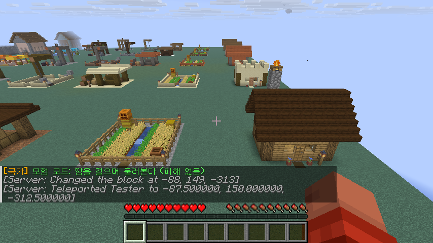
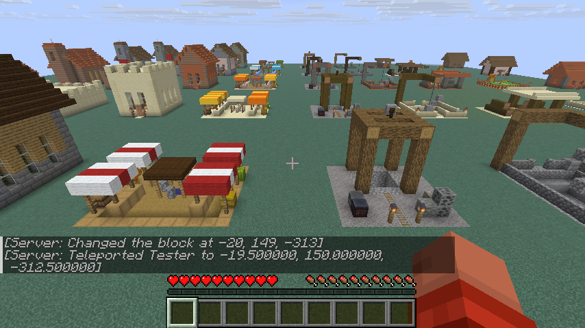
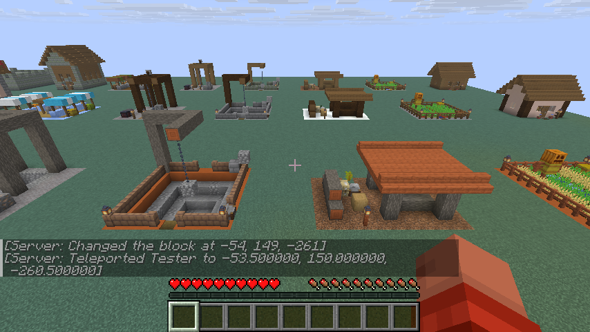
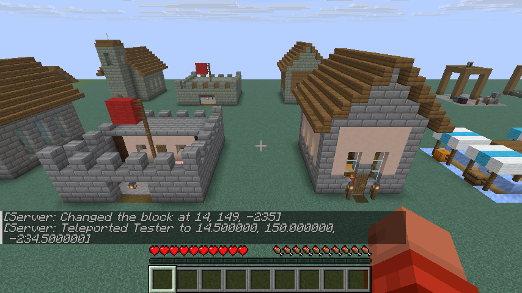
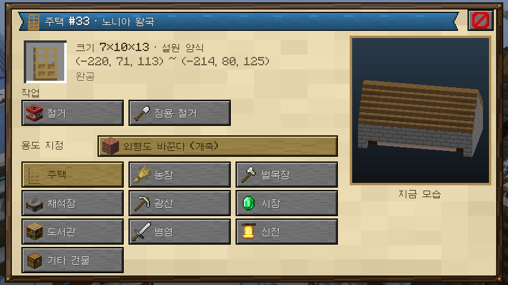
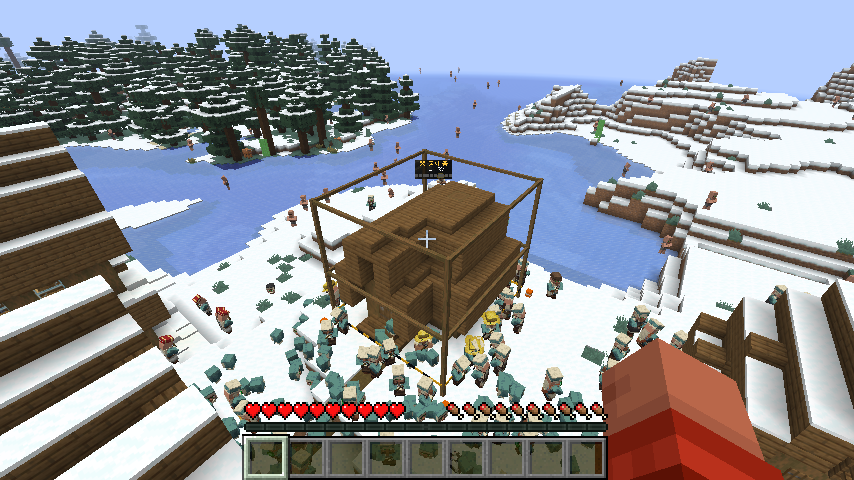

관리 명령: `/gs admin designs`(서 있는 높이에 평평한 전시장을 깔고 50개 설계를 모두 짓는다), `/gs admin design <용도> [slope]`(지형에 맞춰 하나 짓기, slope는 64칸 안의 비탈을 찾아서).

## 1.11 보이는 청크의 주민 모두 렌더링 (2026-10-17, 사용자 요청)

가까운 150명만 보이던 것을 바꿔, 플레이어가 보는 청크(서버 시야 거리와 클라이언트 요청 거리 중 작은 쪽, 최대 16청크)의 주민을 모두 보낸다. 최적화:

- **두 단계.** 48칸 안(최대 150명)은 지금처럼 A*로 걷고 2틱마다 갱신한다. 나머지는 시뮬레이션 위치를 따라 지면 위로 움직이고(4틱마다, 96칸 밖은 12틱마다) 움직였을 때만 보낸다. 지붕·벽 위로 올라가지 않게 "사람이 놓은 블록" 위에서는 거리 높이를 유지한다. 화면에 보이는 먼 주민은 시뮬레이션에서도 4틱마다 걸음을 계산해 움직임이 끊기지 않는다.
- **작은 패킷.** 먼 주민의 이동은 바닐라 엔티티 추적처럼 상대 이동 패킷(약 12바이트, 위치 동기화는 약 60바이트)으로 보내고 100틱마다 정확한 위치로 다시 맞춘다. 고개 회전은 크게 돌 때만. 한 플레이어에게 가는 한 틱의 패킷은 번들 하나로 묶는다.
- **새로 보이는 주민**은 10틱마다, 가까운 순으로, 한 번에 600명까지 띄운다. 새로 생기는 주민은 아무도 못 보는 곳(이제 시야 전체 기준)이나 집 안에서 나타난다.
- **순간이동 방지.** 먼 단계 → 가까운 단계로 넘어갈 때, 지금 보이는 자리에서 한 걸음(1.5칸) 안에 설 곳이 있을 때만 넘긴다. 가까운 단계는 반경 + 8칸까지 유지(히스테리시스)해 경계에서 왔다갔다하지 않는다. 플레이어가 나갔다 들어오면 위치 기준을 지워 옛 위치에서 튀지 않는다. 결과: 가만히 있는 1분 동안 순간이동 기록 102건 → 2건(공사 중 발밑 블록이 바뀐 작업자의 1.3~1.8칸 보정).
- **클라이언트.** 바닐라는 64칸 넘는 주민을 안 그리는데, 주민은 지형과 같은 거리(렌더 거리)까지 그린다. 40칸 밖 주민은 몸통만 그리고 옷 겹(지역·직업·레벨)·든 물건·머리 장식·그림자를 뺀다(한 명당 그리기 5번 → 1번). (이 부분은 1.14에서 CrowdPerf 모드로 옮겼고, 이제 32칸 밖 주민은 옷을 입은 채 한 덩어리로 그린다.)

실측(설원 노니아 왕국 한가운데, 개체 3,400명): 화면에 1,990명(가까이 150명) · 표시 처리 0.24ms/틱 · 서버 MSPT 4.3 · 패킷 약 1,000~2,000/초(18~32KB/초).

## 1.12 E단계: 국기와 데이터 기반 시대·기술·무기·에너지·사상 (2026-10-17)

**국기 (배너)**
- 나라마다 마인크래프트 배너 하나가 국기다: 바탕색(국가색) + 무늬 층(최대 6). 새 나라는 문장학 틀(삼색기·십자·바탕 위 문장·대각선·테두리 문장)에서 국가색과 대비되는 색으로 무작위 국기를 받는다. 예전 세이브의 나라도 자동으로 받는다.
- **끌어다 놓기로 바꾸기**: 나라 메뉴(`G`)의 **국기** 탭에 지금 국기가 크게 보이고, 오른쪽에 가방 속 배너들이 나온다. 베틀에서 만든 배너를 왼쪽 국기 칸으로 끌어다 놓으면 그 무늬가 그대로 국기가 된다(배너는 가방에 남는다). 바닐라 클라이언트는 배너를 들고 `/gs flag`. `무작위 국기` 버튼이나 `/gs flag random`으로 다시 뽑을 수도 있다. 통치자만.
- 국기가 보이는 곳: 수도 광장의 깃발 블록(바뀌면 바로 다시 그린다; 중심이 막혔으면 6칸 안의 빈 자리), 나라 메뉴 제목과 나라 목록, 세계 지도의 수도 표시.

**데이터 기반 콘텐츠 (`config/grandstrategy/content.json`)**
- 시대 13개(석기 → 청동기 → 철기 → 고전 → 중세 → 르네상스 → 산업 → 근대 → 원자력 → 정보 → 근미래 → 원미래 → 항성), 이름 붙은 기술 22개(농경, 바퀴, 문자 … 화약, 증기 기관, 전기, 핵분열, 컴퓨터, 핵융합, 나노 기술, 항성 공학), 무기 17개(곤봉·창 … 화약·대포, 소총·기관총, 전차·항공기, 유도 미사일, 레일건 … 반물질; 대량살상무기로 화학·생물·핵분열탄·수소폭탄·나노·반물질), 에너지 11개(근력 … 석탄·석유·수력·핵분열·태양광·핵융합·인공 태양·다이슨 구조물), 사상 13개(정령신앙·부족주의 … 공화주의·자유주의·사회주의·공산주의·파시즘·기술관료제·트랜스휴머니즘·AI 통치).
- 조건은 모두 데이터: 시대 · 연구 분야별 단계 · 이름 붙은 기술. 시대는 연구 단계 합계로 정해진다(4, 9, 16 … 169: 제곱으로 늘어 뒤로 갈수록 길다). 파일을 고치고 `/gs admin reload`하면 코드 수정 없이 시대·무기·사상이 늘어난다. 잘못된 파일(없는 시대·기술 참조, 없는 블록, 빈 이름, 처음부터 쓸 무기가 없음 등)은 거부하고 기존 내용을 유지한다.
- **효과**: 쓸 수 있는 가장 좋은 재래식 무기가 전투력 배수(곤봉 ×1 → 화약 ×3.2 → 전차 ×6.5 → 반물질 ×24), 가장 좋은 에너지가 모든 생산 배수(장작 ×1.05 → 석탄 ×1.3 → 핵융합 ×2.6 → 다이슨 ×4.5)와 오염(안정도 감소), 사상이 안정·성장·연구·군사·생산 보정. 대량살상무기는 데이터(오염 반경, 인구 손실, 국제 호감도, 낙진 기간)만 정의해 두고 실제 사용은 F단계(전쟁)에서 붙인다. 현실의 제조 정보는 다루지 않는다.
- **시대가 바뀌면 길도 바뀐다**: 길 포장 재료를 시대마다 content.json에 정한다(흙길 → 다진 진흙 → 조약돌 → 석재 벽돌 → 안산암 → 콘크리트 → 심층암 → 석영 → 퍼퍼). 새 시대에 들어서면 그 나라의 길을 한 번에 하나씩 새 재료로 다시 깐다. 시대 진입은 모두에게 알린다.
- **AI**: 통치자 없는 나라는 성향(공격성·확장성·외교성)에 맞는 사상을 고르고 40턴마다 다시 본다. 평화 시 연구는 이제 가장 뒤처진 분야를 올린다(공격적인 나라는 군사, 수중 구조물은 가장 느리게). 전에는 교육·농업·광업·산업만 올려서 항성 시대에도 곤봉을 들었다.
- **나라 메뉴 시대 탭**: 왼쪽에 시대 사다리(지금 시대 강조, 다음 시대까지 막대), 오른쪽에 지금 무기·에너지·사상과 기술/무기/에너지/사상 목록. 잠긴 것은 필요 조건, 열린 것은 효과를 보이고, 사상은 클릭해서 국가 사상으로 삼는다(통치자). 명령: `/gs era`(모든 나라의 시대·무기·에너지·사상·대량살상무기), `/gs ideology <id>`.
- 연구 탭은 9번째 분야(수중 구조물)가 들어가도록 카드 높이를 줄였다. 사교 시간에 온 나라 주민이 한 광장에 몰리던 것도 고쳤다: 3분의 1만 신전·시장·광장 중 한 곳으로 가고 나머지는 집 근처에서 어울린다.

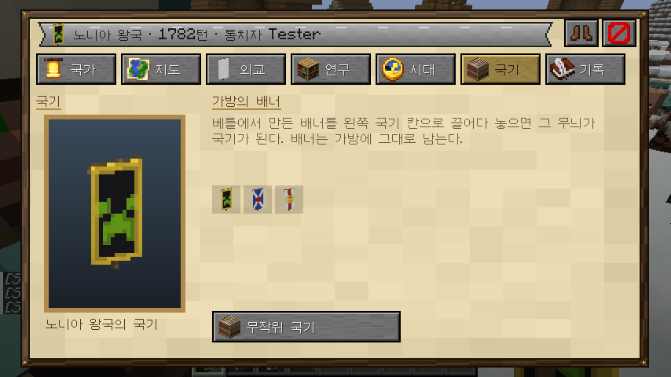
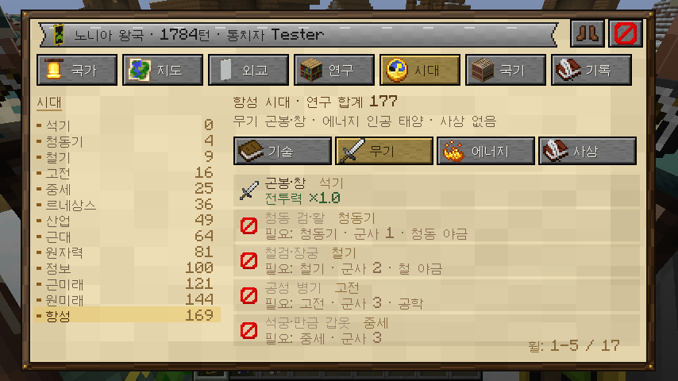
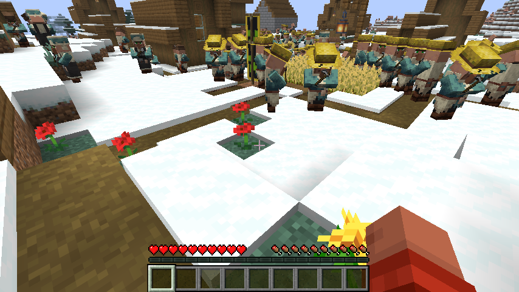
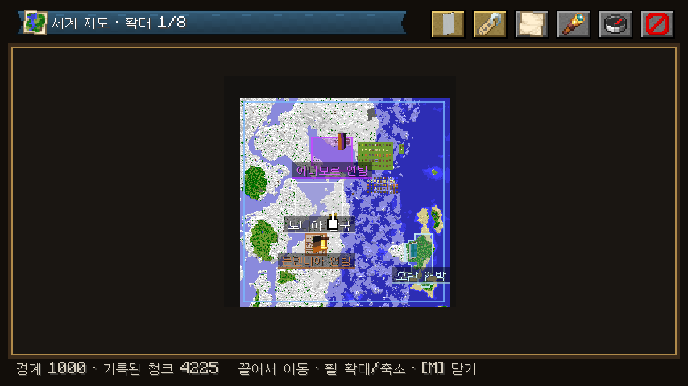

## 1.13 수용 인구 · 과밀 사건 · 국민 분산 (2026-10-17, 사용자 요청)

주민 2,000명쯤에서 렉이 심하고, 국민이 한 곳(수도)에만 몰려 있었다.

**수용 인구 (`Population.capacity`)**
- 나라가 먹이고 재울 수 있는 사람 수 = (땅 + 집 + 시설 + 소유한 마을 + 수도) × 연구 보정 × 시대 보정.
  - 땅: 청크마다 지형별 값(평원 3, 강 3.5, 해안·사바나 2.5, 숲·정글 2, 타이가·언덕 1.5, 설원 1, 사막 0.8, 악지·산 0.5, 물 0).
  - 집 1채 8명, 시설: 농장 15 · 병영 10 · 시장 8 · 벌목장·채석장·광산·도서관 4 · 성벽 2, 수도 30.
  - 농업·행정 연구 단계마다 +2%(최대 ×1.6), 시대마다 +5%.
  - 모두 `balance.json`의 `capacity` 항목으로 조정한다.
- 수용 인구보다 적으면 자란다. 넘으면 **성장이 멈추고**, 넘친 비율만큼 안정도 목표가 내려가고(100% 초과 시 −25) 생산이 줄며(100% 초과 시 −50%, 최저 60%까지), 매 턴 **과밀 사건**이 일어날 확률이 생긴다(초과 비율 × 0.4, 최대 60%).
- **과밀 사건 7가지** (`content.json`의 `crowdEvents`, 데이터로 추가·수정 가능): 전염병(인구 −10%, 전체 공지) · 식량 폭동(식량 35% 약탈) · 빈민가 화재(인구 −3%, 목재 −25%) · 범죄 증가(금 −20%) · 파업(5턴 동안 생산 −25%) · 대규모 이주(인구 8%가 가장 여유 있는 이웃 나라로) · 폭동과 분리(안정도 25 미만에서만, 반란 나라가 떨어져 나감). 사건마다 발생 최저 과밀 비율·가중치·효과·문구를 정한다.
- 나라 메뉴의 인구 칸에 수용 인구를 넘으면 "과밀!"이 붙는다.

**국민 분산**
- **새 마을 구역.** 한 나라의 모든 마을 중심(광장)에서 48칸 안에 건물(성벽 제외)이 16채 이상 차면, 기존 중심에서 5~12청크 떨어진 자기 땅(비옥한 땅·소유한 마을 우선)에 새 구역을 연다: 광장을 깔고 큰길로 잇는다. 영토 50청크마다 구역 하나(수도 포함)까지. 판단은 `sim/Districts.kt`(단위 테스트 `DistrictsTest`), 조정은 `balance.json`의 `roads.districtBuildings · districtRadius · districtSpacing · districtReach · chunksPerDistrict`. `/gs work roads`에 나라마다 "구역 2/4 (건물 19/10, 기준 16)"처럼 구역 수/한도와 중심별 건물 수가 나온다.
- **덜 붐비는 곳부터.** 새 집터는 가장 가까운 마을 중심이 아니라 "거리 + 그 중심에 이미 있는 건물 수 × 4칸"이 가장 작은 곳에서 고른다.
- **일터와 모임.** 농부·나무꾼·광부는 65%가 집 주변 땅에서 일하고, 일터 건물은 집에서 64칸 안의 것만 쓴다. 모임(신전·시장·광장)도 집에서 96칸 안일 때만 가고, 멀면 집 근처에서 어울린다.

실측(60턴): 과밀한 나라들이 1,868/1,485(인구/수용) → 1,631, 1,820/1,400 → 1,577, 1,664/1,343 → 1,531로 줄었고, 이주로 몬덴니아가 1명 → 194명이 되었다. 전염병·화재·파업·이주·범죄 사건이 기록되었다.

**새 마을 구역이 한 번도 안 생기던 문제 (2026-10-17)**

staged_map2를 3,500턴 넘게 돌려도 "New district" 기록이 없었다. 3,511턴 저장 파일로 원인을 찾았다.
- 구역 판단이 "길가에 빈 집터가 하나도 없을 때"(`frontage`)에만 돌았다. 집터 찾기는 모든 길 칸을 뒤지므로 빈 터가 거의 항상 나오고, 그래서 노니아 왕국(광장 주변 28채, 영토 219청크)도 "할 일 없음"에서 멈췄다. → 이제 길 계획을 할 때마다 구역 조건을 본다.
- 에니모르·몬덴니아는 아무도 안 불러온 땅의 길 주문 10개(놓일 날만 기다리는 것)가 쌓여 상한에 걸렸고, 계획이 맨 처음의 "공사 대기 중"에서 끝났다. → 구역은 대기열과 상관없이 연다(구역 수는 영토로 묶여 있어 끝없이 쌓이지 않는다).
- 기준 24채는 대부분의 AI 나라가 닿지 못했다(3,500턴 뒤 나라별 건물 14~28채). → 16채, 성벽은 세지 않는다.
- 광장 자리가 없으면 큰길만 깔리고 중심(광장)이 안 생겨 다음 판단에서 또 구역을 열 수 있었다. → 광장이 들어갈 자리만 고르고 광장을 먼저 깐다.
- 후보 청크 정렬의 비교 기준 안에서 난수를 뽑아 정렬 순서가 어긋날 수 있었다. → 점수를 먼저 한 번 매기고 정렬한다.

실측(개발 서버, staged_map2 복사본, 3,630턴, 플레이어 없음): 불러오자마자 "New district for 에니모르 연방 at chunk [-14, -15]"(광장 21칸 + 큰길 119칸)과 "New district for 몬덴니아 연방 at chunk [-23, 6]"(광장 21칸 + 큰길 143칸)이 기록되었다. 전쟁 중인 두 나라는 매 턴 경제 행동 1개를 징집에 써서 건물을 거의 짓지 않으므로, 시험용 서버에서만 `ai.economicActionsPerTurn`을 4로 올리고 60턴을 돌렸다. 그동안 두 나라가 새로 지은 건물 21채(병영·농장·채석장·광산·도서관)가 **모두 새 구역**에 섰다: 새 광장에서 9~48칸, 수도 중심에서는 44~102칸. 새 구역 건물이 아직 10채라 세 번째 구역은 열리지 않았다. 노니아 왕국은 그사이 반란으로 영토가 5청크로 줄어 구역을 열 수 없었다.

남은 점: AI는 집(HOUSE)을 스스로 짓지 않고 시설만 짓는다. 아무도 안 불러온 땅의 건축 주문은 끝나도 청크가 불러와질 때까지 "진행 중"으로 남아 공사 상한을 채우므로, 지켜보지 않는 나라는 결국 짓기를 멈춘다. 이미 있는 `balance.json`은 예전 값(24)을 그대로 가지고 있으니 새 기준을 쓰려면 16으로 고친다.

## 1.14 최적화: 기존 최적화 모드 + 직접 만든 CrowdPerf (2026-10-17, 사용자 요청)

**1단계: 검증된 최적화 모드 설치 (개발용 서버·클라이언트, Modrinth에서 sha512 확인)**

| 쪽 | 모드 | 하는 일 |
| --- | --- | --- |
| 서버 | Lithium 0.26.2 | 게임 로직(엔티티·블록·AI) 전반 최적화 |
| 서버 | FerriteCore 9.0.0 | 블록 상태·모델 메모리 절감 |
| 서버 | Krypton 0.3.2 | 네트워크 스택 최적화(패킷 묶기·압축) |
| 서버 | ServerCore 1.5.20 | 엔티티 활성 범위, 동적 시야 거리 등 |
| 서버 | C2ME 0.4.2-alpha | 청크 생성·로드 병렬화 |
| 서버 | ScalableLux 0.3.0-alpha | 빛 엔진 병렬화 |
| 클라이언트 | Sodium 0.9.3-beta | 지형·엔티티 렌더링 |
| 클라이언트 | Entity Culling 1.11.3 | 벽 뒤 엔티티 안 그리기(비동기 광선 추적) |
| 클라이언트 | ImmediatelyFast 1.17.1 | 즉시 모드 렌더링(글자·HUD) 묶기 |
| 클라이언트 | Lithium · FerriteCore | 위와 같음 |
| 클라이언트 | Simple HUD Enhanced 4.7.5 | (사용자 요청) 좌표·FPS HUD |

모드는 `run/`(git 제외)에만 있다. 같은 장면(노니아 왕국 위, 주민 약 2,000명 보임): 모드 없이 약 66 FPS → 모드 설치 후 약 230~330 FPS.

**2단계: 그래도 남는 병목 — 프로파일 (JFR, 렌더 스레드)**

`./gradlew runClient -Pjfr=40`(개발용)으로 40초 기록. 주민 1,650명이 보일 때 렌더 스레드의 대부분이 주민이었다: 모델 정점 만들기(ModelPart → 큐브마다 정점) 27%, 렌더 상태 추출(이름표·발광·속성 조회 포함) 15%, 보이는지 검사(Sodium 청크 그래프) 15%, 모델 자세 계산(resetPose·setupAnim·회전 행렬) 10% 이상, 제출 6%. 바닐라는 **매 프레임** 주민 한 명마다 이 일을 다시 한다.

**3단계: CrowdPerf (`crowdperf/`, 별도 모드·별도 jar, 클라이언트 전용)**

조사한 방식: Entity Culling(가려진 엔티티 생략, 안 보이는 엔티티 틱 생략), EntityBoost·SmartEntityOptimizer(먼 몹의 장식 생략·갱신 빈도 낮추기), ELO(거리별 AI 단계), Sodium(큐브 정점을 직접 메모리에 쓰기), 바닐라 구름 렌더러(GPU 버퍼를 한 번 만들고 여러 프레임 그리기). 이 중 "거리별 단계"와 "GPU에 한 번 올려 여러 번 그리기"를 주민 군중에 맞게 합쳤다.

- **먼 주민은 한 덩어리로.** 32칸 밖 주민은 정상 렌더러가 건너뛴다(보이는지 검사도, 렌더 상태도, 모델도 없음). 대신 **틱마다 한 번**, 그 주민들을 모두 정점 버퍼 하나에 쓴다: 바닐라 모델을 기본 자세로 한 번 구워 둔 메시를 위치·몸 방향만 바꿔 복사한다. 이 버퍼를 GPU에 올리고, 매 프레임은 **그리기 한 번**으로 끝난다(바닐라 엔티티 셰이더·조명·안개 그대로). 위치는 서버가 보낸 좌표를 따라 매 틱 움직인다.
- **옷은 한 장의 텍스처로.** 주민은 피부 + 지역 옷 + 직업 옷을 같은 모델에 겹쳐 그린다. 같은 UV를 쓰므로 세 장을 미리 한 장으로 합쳐(알파 컷아웃 규칙 그대로, 모자 숨김 규칙 포함) 64×64 칸 하나로 두고, 모든 모습을 한 아틀라스(1024×1024, 256가지)에 모은다. 그래서 먼 주민도 옷을 입은 채로 보인다(전에는 40칸 밖에서 옷을 빼야 했다).
- **두 거리 단계.** 64칸 밖은 코·모자를 뺀 메시(66 → 48면). 96칸 밖은 두 번째 버퍼에 따로 담아 4틱마다만 다시 만든다(서버도 그 거리의 위치를 12틱마다 보낸다). 넘나드는 주민이 두 번 그려지거나 사라지지 않게 소속은 먼 버퍼를 다시 만들 때만 바꾼다.
- **가벼운 틱.** 덩어리에 든 주민은 클라이언트 틱에서 위치 보간(`commonTick`)과 몸 방향만 하고 나머지(유체·장비·고개·걷기 동작)는 건너뛴다. 가까워지면 원래대로.
- **그대로 두는 경우.** 가까운 주민, 그리고 기본 자세로는 안 되는 주민(발광·이름표·다침·죽는 중·자는 중·탈것·끈·투명)은 바닐라 렌더링 그대로.
- **기존 LOD 이전.** 메인 모드에 있던 "주민을 렌더 거리까지 그리기"와 "멀면 옷·물건·그림자 생략" 믹스인을 CrowdPerf로 옮겼다(설정 `detailDistance`, 덩어리가 꺼져 있을 때 쓰임). 메인 모드는 CrowdPerf를 `recommends`로 둔다.
- 설정 `config/crowdperf.json`, 명령 `/crowdperf [on|off|reload|distance <칸>]`(클라이언트 명령, 어느 서버에서나). 자세한 내용은 [crowdperf/README.md](../crowdperf/README.md).

**결과 (같은 장면, 같은 주민 수 약 1,400~1,500명, 모드 설치 상태에서 CrowdPerf만 켜고 끔)**

| | FPS |
| --- | --- |
| 모드 없음 | 약 66 |
| 최적화 모드만 (덩어리 끔) | 223 ~ 247 |
| + CrowdPerf | 1,427 ~ 1,920 |

덩어리를 켠 뒤 렌더 스레드에서 주민 몫은 덩어리 다시 만들기 약 5%(주민 1,260명에 틱당 1.8ms)뿐이고, 남은 큰 몫은 바닐라 눈 날씨 계산(16%)과 화면 UI다.

## 1.15 CrowdPerf 2판: GPU 인스턴싱 · 걷는 동작 · 화면 밖 생략 (2026-10-18, 사용자 요청)

목표: 시뮬레이션 거리 12청크, 주민 3,000명에서 1,000 FPS 이상, 보이는 모습은 그대로 이상.

조사: Flywheel(Create의 인스턴싱 엔진), Rentities(같은 종류 엔티티를 인스턴스 그리기 한 번으로), GPU Gems 3 2장(정점 셰이더에서 자세를 계산하는 군중), 바닐라 지형의 인스턴스 정점 바인딩.

- **인스턴싱.** 1판은 틱마다 먼 주민의 모든 정점을 CPU에서 만들어 올렸고(주민 2,300명에 틱당 1.8ms) 걷는 동작이 없었다. 2판은 모델을 한 번 구워 GPU에 두고(정점마다 머리·오른다리·왼다리 번호와 회전 축), 틱마다 주민 한 명당 76바이트만 쓴다. 직접 쓴 정점 셰이더가 프레임 시점으로 위치·몸·머리를 보간하고 다리를 걸음 주기대로 흔들며 고개를 돌린다(VillagerModel과 같은 식). 조각 셰이더는 바닐라 엔티티 것 그대로라 색·조명·안개가 같다. 직업 레벨 배지도 아틀라스에 합쳤다(2048×2048).
- **화면 밖 생략.** 인스턴스를 청크별로 묶어 프레임마다 절두체 밖 묶음을 빼고 올린다(보통 3분의 1만 남음). GPU가 기다리던 시간(glClientWaitSync)이 렌더 스레드의 30% → 12%로 줄었다.
- **부드러운 걸음.** 서버가 먼 주민 위치를 4~12틱마다 보내는데 클라이언트는 3틱만 따라가 "걷다 서다"였다. 주민마다 업데이트 간격을 재서 그만큼 이어서 따라간다.
- **가벼운 틱 고침.** Entity Culling이 같은 틱 함수 앞에서 자기 틱을 돌리고 끝내서 CrowdPerf의 가벼운 틱이 실제로는 안 돌고 있었다(주민 aiStep이 프레임의 8%). 우선순위를 앞으로 당겼다. 시야 거리 밖 모서리의 주민(약 500명)도 가벼운 틱만 한다.
- **눈·비 캐시.** 바닐라가 매 프레임 기둥마다 하던 바이옴 섞기 조회를 2초 기억한다(눈 오는 마을에서 렌더 스레드의 14%).
- 개발용: `./gradlew runClient -Pcrowdperf.<설정>=<값>` / `-Pgrandstrategy.<설정>=<값>`이 그대로 시스템 속성으로 넘어간다. 캡처 모드 스크린샷 간격 `grandstrategy.captureTicks`, 최대 장수 `grandstrategy.captureLimit`(기본 300, 하룻밤 짧은 간격으로 7GB가 쌓인 뒤 추가), 작업 지정 자동 켜기 끄기 `grandstrategy.captureWork=false`, 실행 중인 클라이언트 프로파일은 `jcmd <pid> JFR.start`.

**결과** (서버 시야·시뮬레이션 거리 12청크, 주민 약 2,800~3,000명 수신, 그중 약 2,300명 인스턴스·화면 안 약 940명, 같은 자리):

| | FPS |
| --- | --- |
| CrowdPerf 끔 | 283 ~ 308 |
| CrowdPerf 2판, 보통 플레이(매 프레임 다시 고르고 올림) | 3,250 ~ 3,770 |
| CrowdPerf 2판, 작업 지정 화면 켬 | 2,510 ~ 2,830 (눈 오고 공사가 많던 때 860 ~ 1,210) |

작업 지정 화면이 켜져 있을 때 남는 큰 비용은 건물 외곽선(바닐라 기즈모의 반투명 면 정렬)과 패널 글자다.

**같이 고친 것: 수도가 매 턴 함락되던 문제.** 수도를 잃으면 가장 가까운 자기 땅으로 옮겼는데, 그 땅이 곧 전선이라 다음 턴에 또 함락되고, 그때마다 "수도 함락" 컷신이 12초마다 반복됐다(노니아 왕국이 이렇게 나라 끝까지 밀렸다). 이제 새 수도는 적 땅에서 가장 먼(자기 땅을 거쳐 센 거리) 곳으로 가고, 같은 나라의 수도 함락 컷신은 30턴에 한 번만 나온다. 테스트 `WarfareTest`.

## 1.16 행정구역 · 세 칸 길 · Iris (2026-10-18, 사용자 요청)

**행정구역** (`sim/Districts.kt`)
- 나라의 모든 청크는 행정구역 하나에 속한다. 구역마다 중심(청사 자리)이 있고, 첫 구역은 수도에서 다스리는 "수도 구역"이다.
- **한 구역이 담을 수 있는 청크 수는 연구에 따라 늘어난다**: 기본 16청크, 행정 연구 1단계마다 +4, 물류 1단계마다 +2, 최대 160(`balance.json`의 `districts`).
- 새로 얻은 청크는 이웃한 구역 중 자리가 남은 곳(중심이 가장 가까운 곳)에 들어간다. **이웃 구역이 모두 가득 찼으면 새 행정구역이 생기고**, 그 청크가 새 구역의 중심이 된다("○○: 행정구역이 가득 차 새 행정구역 △△을(를) 두었다"). 이름은 그 자리의 마을 이름이나 지어낸 지명(○○ 주·군·현·도).
- 땅을 잃으면 구역에서 빠지고, 빈 구역은 없어지고, 중심을 잃은 구역은 남은 땅 중 가까운 곳으로 중심을 옮긴다. 정복한 땅은 정복한 나라의 구역 규칙을 따른다. 나라가 망하면 구역도 함께 사라진다.
- 예전 세이브는 다음 턴에 수도에서 바깥으로 차례로 구역이 나뉜다.
- **중심 광장**: 4청크 이상인 구역은 중심 근처에 광장을 깔고 기존 길까지 간선 도로를 잇는다(전에는 "모든 마을 중심에 건물 16채 + 영토 50청크마다 하나"라는 별도 규칙이었다). 새 집은 덜 붐비는 광장부터 지어지므로 국민이 구역마다 퍼진다.
- 보는 곳: 나라 메뉴 개요의 영토 아래 "행정구역 N개 · 구역당 M청크까지", `/gs districts`(구역마다 크기·중심·광장 여부), 세계 지도(같은 나라 안 구역 경계 점선, 확대하면 구역 이름, 아래 줄에 커서 위치의 구역). 지도 위 버튼으로 행정구역 표시를 켜고 끈다.

**길은 세 칸**
- 모든 길(골목·새 길·간선 도로·구역 간선)을 계획한 선 양쪽으로 한 칸씩 넓혀 3칸으로 깐다(정사각 붓이라 모퉁이도 꽉 찬다). 건물·벽·한 칸 넘는 턱 옆에서는 그만큼 좁아진다. 너비는 `balance.json`의 `roads.width`(홀수).
- 이미 깔린 1칸 길도 한 번씩 넓힌다: 같은 종류의 옛 길 12개(새 칸 약 300개)까지를 한 번의 공사로 묶는다. 플레이어가 직접 깐 길은 손대지 않는다.
- 건물 터는 여전히 길에서 한 칸 마당을 두고, 길 3칸 안에만 지을 수 있다.

**Iris**
- 개발 클라이언트에 Iris 1.11.7(26.3)을 설치했다(Modrinth, sha512 확인, Sodium 0.9.x 필요). 셰이더 팩은 `run/client/shaderpacks/`에 넣으면 된다(추후 제공).
- 셰이더 팩이 켜져 있으면 팩이 세상을 자기 버퍼와 프로그램으로 그리므로 CrowdPerf의 인스턴스 그리기는 거기 끼지 못한다. 그래서 CrowdPerf는 Iris API로 팩 사용을 확인해, 켜져 있는 동안 주민을 일반 렌더러로 돌려준다(팩이 그림자·조명을 입힌다). 팩이 없으면 지금처럼 인스턴스로 그린다. 팩을 켠 상태의 성능은 팩을 받은 뒤 다시 잰다.

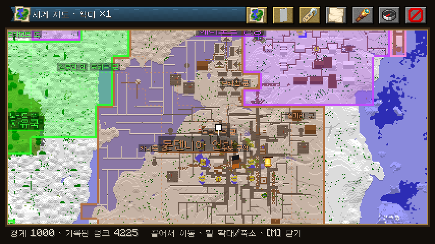
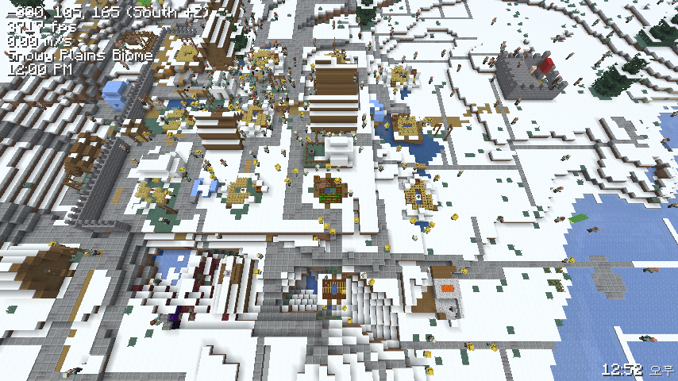

## 2. 월드박스식 핵심 시스템 (자동 요소)

| 시스템 | 동작 |
| --- | --- |
| 주민 | 나이, 성별, 직업(농부·나무꾼·광부·건축가·병사·학자…), 배고픔, 행복, 소속 가문, 성향. 태어나고, 일하고, 늙고, 죽는다 |
| 집 짓기 | 인구가 주거를 넘으면 건축가가 도시 중심에서 바깥으로 빈 터를 찾는다. 경사·물·기존 건물 검사 → 도로와 연결된 부지 선택 → 자재(목재·석재) 소모 → 건물 배치 |
| 건물 | **마인크래프트 기본 jigsaw 구조물**을 쓴다. 바닐라 마을 템플릿 풀(평원·사막·사바나·타이가·설원)을 바이옴에 맞게 고르고, 시대가 오르면 우리 템플릿 풀(석조·산업·현대·미래)로 바꾼다 |
| 도시 성장 | 마을 → 읍 → 도시 → 대도시. 단계마다 중심 건물(종 → 시청 → 궁전 등)과 도로 폭이 바뀐다 |
| 통치자 | 왕·지도자 개체가 실제로 존재한다. 성향(호전·외교·탐욕·현명)이 국가 AI 가중치가 된다. 사망하면 계승(세습·선거·찬탈)하고, 계승 분쟁은 내전으로 이어질 수 있다 |
| 가문·집단 | 귀족 가문, 종교, 길드, 정당. 충성도와 영향력을 가지며 반란·쿠데타의 주체가 된다 |
| 자유 마을 | 지금처럼 국가가 아닌 독립 세력. 개체 기반으로 바뀔 뿐이다 |

---

## 3. 넓은 스펙트럼: 고대부터 미래까지

거의 모든 요소에 시대 축을 둔다. 전부 **데이터 파일(JSON)**로 정의해서 코드 수정 없이 늘릴 수 있게 한다 (balance.json과 같은 방식, `/gs admin reload`로 반영).

| 분야 | 고대 → 미래 예시 |
| --- | --- |
| 시대 | 석기 → 청동기 → 철기 → 고전 → 중세 → 르네상스 → 산업 → 근대 → 원자력 → 정보 → 근미래 → 원미래 → 항성 |
| 무기 | 곤봉·창 → 검·활 → 화약·대포 → 소총·기관총 → 전차·항공기 → 핵분열탄 → 수소폭탄 · 화학·생물무기 → 레일건·지향성 에너지 → 나노 무기·반물질 |
| 에너지 | 근력·가축 → 장작 → 수차·풍차 → 석탄 → 석유 → 수력 → 핵분열 → 태양광·풍력 → 핵융합 → 인공 태양 → 다이슨 구조물 |
| 자원 | 식량·목재·석재 → 구리·철·금 → 석탄·석유 → 우라늄 → 희토류 → 헬륨-3 → 반물질·이그조틱 물질 |
| 사상 | 정령신앙·부족주의 → 신권·군주제 → 봉건제 → 공화주의 → 자유주의·사회주의·공산주의·파시즘 → 기술관료제 → 트랜스휴머니즘·AI 통치 |
| 정치 | 정부 형태, 법률, 선거, 쿠데타, 혁명, 검열, 계엄 |
| 집단 | 부족 → 가문 → 길드·교단 → 정당·노조 → 기업 → AI 집합체 |

대량살상무기는 게임 효과로만 존재한다 (청크 오염, 인구 감소, 국제 제재와 호감도 폭락, 핵 겨울 같은 세계 사건). 실제 제조 정보 같은 현실 지식은 다루지 않는다.

---

## 4. 국기: 마인크래프트 배너 조합

- 나라마다 배너 바탕색과 무늬 층(`BannerPatternLayers`)을 가진다. 기본값은 무작위 조합이고, 국가색과 어울리게 생성한다.
- 플레이어가 베틀에서 만든 배너를 국가 메뉴의 국기 칸에 **끌어다 놓으면** 국기가 바뀐다 (아이템의 배너 무늬 컴포넌트를 읽는다. 아이템은 돌려준다).
- 국기는 GUI 아이콘, 수도 깃발 블록, 컷신(클라이언트의 배너 깃발 모델 렌더러)에 같은 무늬로 나온다.

---

## 5. 월드 준비: 크기 5단계 + 미리 생성

메뉴(GUI)에서 고른다.

| 단계 | 크기 (블록) | 대략 청크 수 |
| --- | --- | --- |
| 1 | 500 × 500 | 1천 |
| 2 | 1000 × 1000 | 4천 |
| 3 | 2000 × 2000 | 1.6만 |
| 4 | 3500 × 3500 | 4.8만 |
| 5 | 5000 × 5000 | 9.8만 |

고르면 월드 경계를 설정하고, Chunky가 설치돼 있으면 같은 범위를 미리 생성한다 (진행률을 보스바로 표시). 미리 생성이 끝나야 지도와 시뮬레이션이 모든 땅을 안다.

---

## 6. 지도

Xaero's World Map / uNmINeD를 참고해 직접 만든다.

- 지형을 위에서 본 픽셀 지도. 블록의 지도 색 + 높이 음영(uNmINeD식), 물 깊이 표현
- 확대·축소·끌어서 이동, 좌표 표시, 웨이포인트
- 겹침 표시: 국경(국가색 반투명 채움과 테두리), 수도·도시 아이콘, 자유 마을, 전선, 군대 위치
- 미리 생성된 범위를 서버가 타일로 렌더링해서 클라이언트에 보낸다. 클라이언트는 캐시한다

---

## 7. 플레이어의 위치: 조물주 / 관전자

- 접속하면 기본으로 **관전자 모드**다. 메뉴에서 **모험 모드**로 바꿀 수 있다 (땅을 걸으며 마을을 보는 용도).
- 플레이어는 **항상 피해를 입지 않는다.** 몹도 노리지 않는다 (지금 컷신 보호 장치를 상시 적용으로 확장).
- 국가를 맡아 "통치"하거나, 아무 나라에도 속하지 않고 세계를 관찰·개입(재해, 축복, 국가 생성, 속도 조절)할 수 있다.

---

## 8. 메뉴 GUI

클라이언트 모드가 있으면 전용 화면을, 없으면 지금의 상자 메뉴를 쓴다. 디자인은 계속 마인크래프트 고유 스타일(기본 GUI 텍스처, 아이템 아이콘, 기본 글꼴)이다.

탭: 세계(크기·미리 생성·속도) / 지도 / 국가 / 국기 / 기술·시대 / 군사 / 외교 / 사상·정치 / 기록 / 관찰자 도구

---

## 8.5 건물 디자인 늘리기 (사용자 요청, 예정)

유튜브·검색으로 찾은 건물 디자인을 직접 지어 에셋(구조물 템플릿)으로 만든다. 원칙:

- 남의 스케매틱 파일을 그대로 넣지 않는다. 배포 조건이 명시된 것(CC0 등)만 출처를 적어 쓴다.
- 영상·사진은 형태와 양식만 참고하고, 블록 배치는 이 프로젝트에서 새로 만든다 (코드로 생성하거나 직접 지어 `structure` 파일로 저장).
- 시대별(석기 → 중세 → 산업 → 현대 → 미래) × 바이옴 양식으로 늘리고, 작업 지정 모드의 건물 목록에 그대로 붙는다.

## 9. 진행 순서

| 단계 | 내용 | 완료 기준 |
| --- | --- | --- |
| **A** ✅ | 개체 LOD 기반 (L0 데이터 + L1 패킷 표시) + 벤치마크 | 개체 20,000~100,000 / 플레이어 1에서 TPS 20 측정 완료. 10인은 미측정 |
| B | 월드박스식 주민 행동 + jigsaw 집 짓기 + 도시 성장 + 통치자 | AI 국가가 실제 건물을 짓고 커지는 것이 월드에서 보임 |
| C ✅ | 월드 준비 GUI (크기 5단계, Chunky 연동, 조물주 모드) | 새 월드에서 메뉴만으로 시작 가능 |
| D ✅ | 지도 | 국경·도시가 지도에 실시간 반영 |
| E ✅ | 국기(배너) + 데이터 기반 콘텐츠 틀 (시대·기술·무기·에너지·사상; 자원은 다음에) | JSON만 고쳐 새 무기나 시대 추가 가능 |
| F | 전쟁 고도화 (개체 군대, 전선, 보급, 대량살상무기 효과) + 정치·집단 | 전쟁이 월드와 지도에서 보이고, 정치 사건 발생 |
| 상시 | 컷신 개선 | 사용자 피드백 반영 |

A가 B~F 전부의 바닥이라 먼저 한다. 지금 MVP의 국가·외교·전쟁 로직은 버리지 않고 개체 위로 옮긴다.

---

## 10. 알려진 문제

- 26.3 개발용 클라이언트가 블록 디스플레이 개체를 그리지 않는다(바닐라 `summon block_display`도 안 보임, 아이템·글자 디스플레이는 보임). 그래서 공사 표시는 아이템 디스플레이로 만들었다. 실제 런처 클라이언트에서도 그런지는 확인하지 않았다.
- 26.3에서 낮밤 게임 규칙 이름이 `minecraft:advance_time`으로 바뀌었다(`doDaylightCycle`은 없음).
- CrowdPerf: 인스턴스 주민은 든 물건을 그리지 않는다. Iris 셰이더 팩이 켜지면 주민을 일반 렌더러로 돌려주는데, 실제 팩으로는 아직 시험하지 않았다(팩 받은 뒤). 개발 중 `runClient`/`runServer`는 메인 프로젝트에서만 돈다(하위 프로젝트의 실행 작업은 끔).
- 개발용 클라이언트가 실행 1~2분 만에 네이티브 힙 손상(0xC0000374)으로 한 번 꺼졌다. 같은 조건으로 2시간 넘게 돌려도 재현되지 않아 원인을 확인하지 못했다.

- 개발용 클라이언트(`runClient`)가 실행 직후 글꼴을 불러올 때 절반 정도 확률로 네이티브 크래시(0xC0000005, JVM 크래시 로그 없음)가 난다. 모드 코드가 돌기 전 단계라 그래픽·오디오 드라이버 등 환경 문제로 보이지만 확정하지 못했다. 다시 실행하면 뜬다. 실제 런처 클라이언트에서도 나는지는 확인하지 않았다.
