# Minelization 로드맵 (설계 v0.3)

2026-10-16 사용자 요구사항을 반영해 [DESIGN.md](DESIGN.md)의 MVP 위에 쌓을 큰 방향을 정리한다. 지금 코드는 "청크 단위 추상 시뮬레이션" MVP이고, 아래는 그것을 **월드박스식 개체(주민) 기반 시뮬레이션**으로 키우는 계획이다.

---

## 0. 원칙: "그대로 가져오기"의 범위

| 가져온다 | 가져오지 않는다 |
| --- | --- |
| 월드박스·문명·하츠 오브 아이언의 **규칙과 시스템** (주민 이동, 집 짓기, 통치자 계승, 외교, 전선·보급 등) | 그 게임들의 **코드, 이미지, 소리, 문구** |
| 공개 위키, 실제 플레이 관찰, 공개 개발 자료에서 알아낸 동작 | 디컴파일한 바이너리 (해당 EULA가 금지하고, 공개 GitHub에 올리면 저작권 침해) |

게임 규칙과 메커니즘 자체는 저작권 대상이 아니다. 동작은 똑같이 재현하되, 구현은 이 프로젝트에서 새로 쓴다. 월드박스 파일을 주더라도 **코드를 읽어 옮기지는 않는다.** 대신 실행 화면, 설정 파일의 수치처럼 플레이로 관찰할 수 있는 정보는 참고할 수 있다.

외부 모드도 같은 기준이다.

| 대상 | 라이선스 | 쓰는 법 |
| --- | --- | --- |
| Chunky (미리 생성) | GPL-3.0 | 우리 jar에 넣지 않는다. 설치돼 있으면 `chunky` 명령을 서버 명령으로 호출 (코드 링크 없음) |
| ServerCore (서버 최적화) | MIT + 일부 GPL | 함께 설치를 권장하는 동반 모드. 코드 복사 없음 |
| Xaero's World Map | 저작권 보유 (비공개) | 화면 구성만 참고, 직접 구현 |
| uNmINeD | 비공개 | 지형 음영 방식만 참고, 직접 구현 |

---

## 1. 가장 중요한 것: 주민 6000명 이상을 부하 없이

### 1.1 문제

바닐라 주민은 몹 중에서도 가장 무겁다. 매 틱 돌아가는 Brain(감각기·기억·행동)과 경로탐색이 비용의 대부분이고, 서버 운영 쪽에서 쓰는 처방은 전부 "AI를 덜 돌리기"다.

- Pufferfish DAB: 플레이어에게서 멀수록 주민 Brain을 드물게 틱
- Paper/ServerCore Activation Range: 먼 엔티티의 틱을 건너뜀
- "Lobotomize": 경로탐색 AI를 아예 제거

6000명을 진짜 `Villager` 엔티티로 두면 이 처방을 다 써도 버티기 어렵다. 엔티티 하나하나가 추적·충돌·패킷 비용을 낸다 (courierpost 측정: 닭 1000마리만 띄워도 TPS 20 → 4.45).

### 1.2 해법: 개체 LOD (3단계)

주민을 **엔티티가 아니라 데이터**로 둔다. 화면에 보일 필요가 있을 때만 몸을 만든다.

| 단계 | 대상 | 표현 | 서버 비용 |
| --- | --- | --- | --- |
| L0 데이터 | 전원 (수천~수만) | 배열에 담긴 위치·집·직업·상태·소속. 1초에 1번(멀면 더 드물게) 갱신. 경로는 마을 도로 그래프 위 노드 이동 | 거의 0 (배열 순회) |
| L1 표시 | 플레이어 48블록 안, 1인당 최대 약 150명 | **엔티티 없이 패킷만**으로 보여준다. 모드 클라이언트는 우리 패킷을 받아 클라이언트 전용 모델로 그리고, 바닐라 클라이언트에는 가짜 엔티티 생성·이동 패킷을 보낸다. 서버에는 Entity 객체가 없다 | 패킷 전송뿐 |
| L2 실체 | 플레이어가 직접 상호작용하거나 전투에 휘말린 소수 | 진짜 `Villager` 엔티티. 단, 바닐라 Brain 대신 가벼운 전용 행동 | 일반 엔티티 |

- L0의 이동은 월드박스처럼 "목적지(밭, 광산, 집, 시장) → 도로 노드 따라 걷기"로 단순화한다. 블록 단위 A* 탐색은 하지 않는다.
- 인구 숫자 = L0 개체 수. 인구가 늘면 개체를 추가하고, 죽으면 제거한다.
- 측정 목표: 개체 20,000명 + 플레이어 10명에서 TPS 19.5 이상, 시뮬레이션 틱 2ms 이하. 벤치마크를 테스트로 만들어 회귀를 막는다.
- 동반 설치 권장: ServerCore, Lithium (L2와 일반 몹에 효과).

### 1.3 A단계 결과 (2026-10-16 구현·측정)

L0 + L1 구현 완료. L2(실체)는 B단계에서 상호작용이 생길 때 붙인다.

- **L0** `sim/Agents.kt`: 위치·목표·집·속도·타이머·소속·직업·상태를 배열로 저장한다. 빈 슬롯을 재사용해서 인덱스가 바뀌지 않는다. 먼 개체는 20틱에 한 번(1/20씩 나눠서), 표시 중인 개체는 2틱에 한 번 걷는다. 매 턴 인구에 맞춰 개체 수를 맞추고, 집이 남의 땅이 되면 그 나라 사람이 된다 (정복 시 주민 귀속).
- **L1** `mc/AgentDisplay.kt`: 플레이어 48블록 안 가까운 150명을 바닐라 엔티티 패킷(생성·위치 동기화·머리 회전·제거)으로만 보여준다. 서버에는 Entity 객체가 없다. 바이옴별 주민 외형과 직업복(농부 모자 등)을 템플릿 주민 1개에서 복사한 데이터로 입힌다. 바닐라 클라이언트에서도 보인다.

**실측** (26.3 전용 서버, 플레이어 1명이 가장 붐비는 수도 위)

| 조건 | 서버 MSPT | TPS |
| --- | --- | --- |
| 개체 0 | 2.3 ms | 20 |
| 개체 20,000 (표시 150) | 2.3 ms | 20 |
| 개체 100,000 (표시 150) | 2.3 ms | 20 |
| 비교: 바닐라 주민 1,000 | 42 ms | 20 (한계 직전) |
| 비교: 바닐라 주민 2,000 | 94 ms | 10.5 |

- 개체 처리 시간: 20,000명에서 평균 0.03~0.5 ms/틱, 100,000명에서 최대 1.6 ms/틱 (격자 재구성 틱)
- 단위 테스트 벤치마크: 20,000명 L0만 0.015 ms/틱, 인구 동기화 1.4 ms/턴
- 네트워크: 플레이어 1명당 초당 패킷 1,500~2,600개, 약 34~58 KB/초

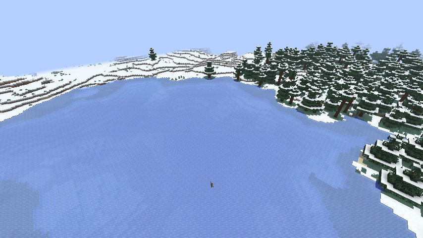

**아직 확인하지 못한 것 / 남은 문제**

- 플레이어 10명 동시 접속은 측정하지 못했다 (개발 클라이언트가 1개뿐). 플레이어당 표시 비용은 0.5 ms/틱 안팎이므로 10명이면 약 5 ms/틱 이하로 추정한다. 실측이 필요하다.
- 걷는 길이 직선이라 물 위나 얼음 위를 걷기도 하고, 집의 1/3이 수도 청크에 몰려 뭉쳐 보인다. B단계에서 도로 그래프와 실제 집 건물로 바꾼다.
- 표시된 주민을 클릭해도 아무 일이 없다 (서버에 실체가 없음). L2에서 해결한다.
- 대역폭을 더 줄이려면 멀리 있는 표시 개체의 갱신 주기를 늘린다.

---

## 1.4 자연스러운 주민 행동 (2026-10-17)

사용자 요구: 순간이동 같은 부자연스러운 행동 금지, 행동 패턴은 MineColonies 참고. MineColonies(GPL-3.0)의 코드는 쓰지 않고 시민 생활 방식(집·직장·일과·비 피하기)만 참고했다.

- **일과**: 새벽(23300~1000) 집 근처 → 낮(1000~10500) 직업 건물로 출근해 일 → 저녁(10500~12500) 모임 장소(신전·시장, 없으면 수도)에서 어울림 → 밤과 비 오는 날 귀가. 집이 실제 주택이면 문 앞에서 집 안으로 들어가 보이지 않게 되고(취침) 아침에 다시 나온다. 주택 1채당 5명.
- **직업 건물**: 농부→농장, 나무꾼→벌목장, 광부→광산·채석장, 상인→시장, 학자→도서관·신전, 병사→병영·성벽. 건물이 없으면 집 근처를 돌아다닌다. 아이는 모임 장소 근처에서 논다.
- **길찾기**: 플레이어 근처(표시 중)인 주민만 블록 단위 A*로 걷는다 (8방향, 1칸 오르기·3칸 내려가기, 2칸 높이 공간, 물·용암 회피, 문은 통과, 울타리·담 위는 못 섬, 지붕 위는 비용 가산). 경로는 직선 구간을 합쳐 단순화. 갈 수 없으면 가장 가까운 지점까지만 간다.
- **순간이동 방지**: 보이기 시작하는 순간 주변 9×9에서 땅 높이를 추정해 바닥(지붕·동굴 아님)에 먼저 올려놓고 나서 보여준다. 새로 태어나는 주민은 플레이어 시야 밖에서 생겨 걸어 들어오고, 인구가 줄 때는 보이는 주민을 지우지 않는다.
- **겉모습**: 직업별 도구를 든다(괭이·도끼·곡괭이·삽·에메랄드·책·검). 일할 때 고개를 숙인다. 걷는 방향을 본다.
- **부하 분산**: 보이기 시작할 때 자리 잡기는 2틱에 25명까지, 경로 탐색은 틱당 6회까지.

실측 (개체 20,000, 정글 지형, 해 뜰 때 150명이 한꺼번에 보이기 시작하는 상황 포함): **순간이동 0건** (보이는 주민이 2틱 사이에 1.2블록 넘게 움직이면 기록), 경로 탐색 평균 0.27ms, 개체 처리 최대 2ms/틱, MSPT 1.7~2.1.

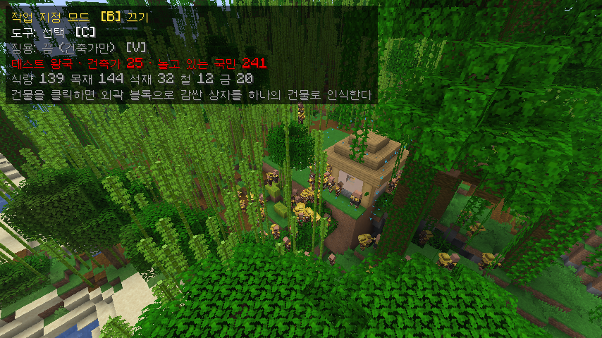

## 1.5 작업 지정 모드 (2026-10-17, B단계 첫 부분)

사용자 요구로 **건물 자동 건설은 폐지**하고, 모든 건설·철거를 "작업 지시"로 한다. AI 나라도 같은 작업 지시 체계를 쓴다 (AI가 자리를 골라 지시를 낼 뿐, 실제 공사는 인부가 한다).

| 기능 | 내용 |
| --- | --- |
| 작업 지정 모드 | 관전자 모드 전용. `B`로 켠다. 좌클릭 드래그로 영역, `C` 도구(선택·건축·성벽·철거·평탄화), `Z/X` 건물 종류, `R` 회전, `V` 징용, `Enter`/우클릭 지시 |
| 건축 | 바닐라 마을 구조물 템플릿(평원·사막·사바나·타이가·설원 126종)을 바이옴에 맞게. 기초 흙 채우기 → 아래층부터 한 블록씩 |
| 성벽 | 드래그한 영역 둘레에 석재 벽돌 성벽 |
| 철거 | 영역 안의 건축 블록(지형·식생 제외)을 위에서부터 제거. 건물 단위 철거도 가능 |
| 평탄화 | 중앙값 높이로 깎고 메운다 |
| 건물 인식 | 클릭한 블록에서 건축 블록을 따라가 외곽을 잇는 직육면체를 하나의 건물로 등록. 나무 줄기(잎 2칸 이내 원목)·덩굴·코코아 등은 제외 |
| 건물 편집 | 철거, 철거(징용), 용도 지정(주택·농장·…), 인식 해제 |
| 인부 | 건축가 직업 주민이 현장까지 실제로 걸어가 작업. 징용을 켜면 일반 국민도 동원(병사·아이 제외). 현장에 도착한 인원만 속도에 반영 |
| 속도 | 인부 1명당 0.6블록/초 × 기술(건축: 건설·산업, 철거/평탄화: 광업·산업) |
| 표시 | 영역 테두리 입자(가능 초록 / 불가 빨강), 건물 테두리(우리 하늘색, 공사 중 주황, 선택 노랑), HUD 패널 |
| 먼 곳 | 청크가 안 불러와진 곳은 진행만 추상 계산하고, 불러와지는 순간 남은 블록을 한꺼번에 배치 |
| 바닐라 클라이언트 | `/gs work build|walls|flatten|demolish|select|building|orders|buildings` 명령으로 같은 기능 |

검증: 26.3 서버+클라이언트에서 정글 16×16 평탄화(인부 16명) → 주택 건설(7×7×7) → `/place template`으로 놓은 바닐라 집 자동 인식(정확히 7×7×7) → 용도 지정 → 주택 철거까지 실제로 확인. 주문은 서버 재시작 후에도 이어졌다.

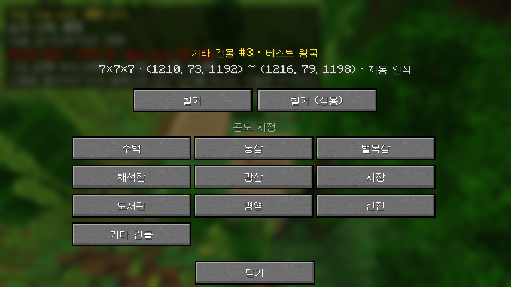

남은 문제: 드래그·우클릭은 실제 마우스로 아직 못 눌러봤다(명령으로만 시험). UI는 바닐라 버튼 그대로라 디자인 작업이 필요하다. 주민이 직선으로 걷고 지붕 높이에 붙는 등 움직임이 부자연스럽다 → 다음 작업.

## 1.6 UI 디자인 (2026-10-17)

UI 라이브러리를 조사했다. owo-lib은 26.2까지만 지원하고, YACL은 설정 화면 전용이라 맞지 않았다. 그래서 마인크래프트 픽셀 스타일의 자체 UI 부품을 만들었다.

- 텍스처: `tools/gen_gui_textures.py`가 표준 라이브러리만으로 PNG를 생성한다. 금 리벳 나무 테두리의 어두운 패널과 양피지 패널, 입체감 있는 돌 버튼(보통·금색 강조·눌림), 국가색으로 물드는 리본, 진행 막대, 아이템 칸.
- 코드: `client/ui/Ui.kt`. 9분할 패널, 리본, 진행 막대, 아이템 칸, 아이콘 버튼(`IconButton`).
- 작업 지정 HUD: 국가색 리본 머리말, 도구 5칸(선택 중인 도구는 금테), 건물 카드, 징용·인력, 자원 아이콘, 작업별 진행 막대.
- 건물 편집 화면: 양피지 패널, 건물 아이콘과 정보, 아이콘 버튼(철거·징용 철거·인식 해제), 용도 지정 격자(현재 용도는 금색).

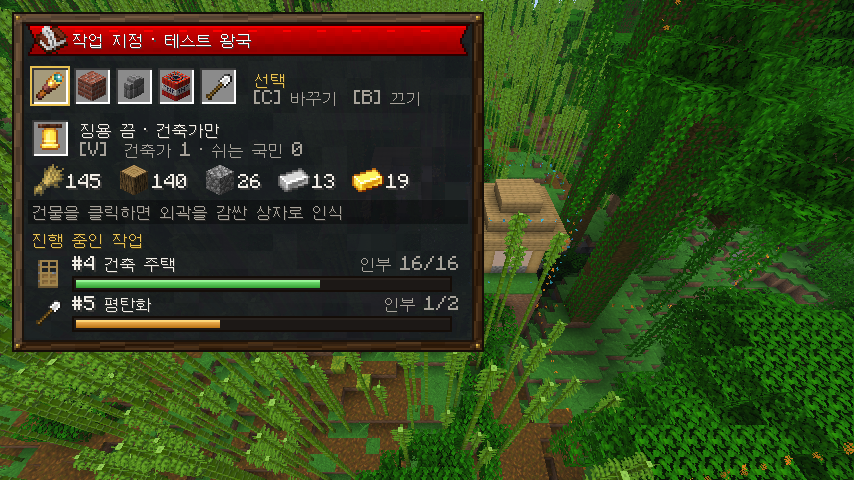
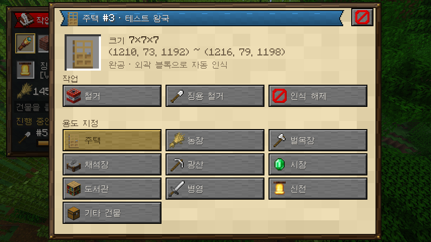

**나라 메뉴** (`G` 키 또는 `/gs`. 클라이언트 모드가 없으면 기존 상자 메뉴, `/gs chest`로 언제든 상자 메뉴): 양피지 패널에 탭 5개.

| 탭 | 내용 |
| --- | --- |
| 국가 | 자원(보유·턴당 증감), 인구·병력·안정도·연구·영토 막대, 징집, 현 청크 편입, 정책 5종, 자동 통치, 답을 기다리는 제안의 수락·거절 |
| 지도 | 주변 29×19 청크. 불러온 청크는 실제 꼭대기 블록 색, 나머지는 지형 색. 국가색 칠과 국경선, 수도 깃발, 마을 종, 건물 점, 현재 위치. 맞닿은 무주지를 클릭하면 편입 |
| 외교 | 나라 목록(호감도 막대·조약 아이콘·전쟁 표시) → 상세(조약 제안·파기, 두 번 눌러 선전포고, 평화 제안), 자유 마을 목록(영향력 막대, 사절·정복) |
| 연구 | 8분야 카드(레벨·효과·진행 막대, 클릭해서 연구 분야 지정), 시설 8종 (클릭하면 알맞은 자리에 건설 지시) |
| 기록 | 최근 사건, 종류별 아이콘 |

**컷신 문구**: 건국은 펼쳐지는 양피지 명판과 금색 리본, 수도 함락은 붉은 리본의 어두운 명판(양국 깃발), 멸망은 어두운 명판에 취소선.

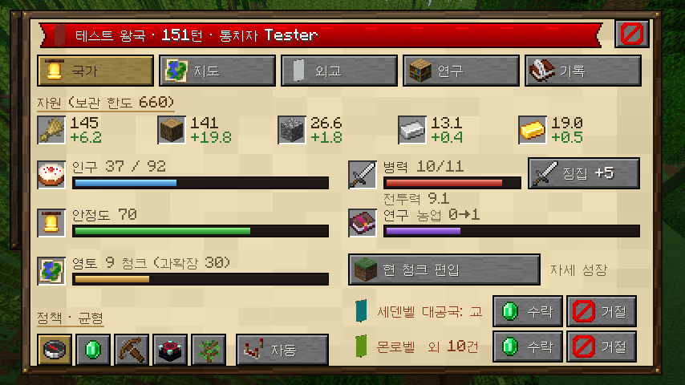
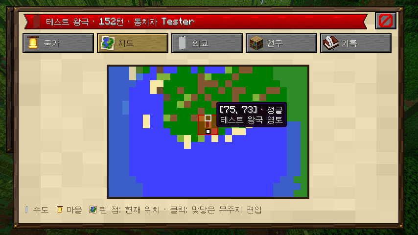
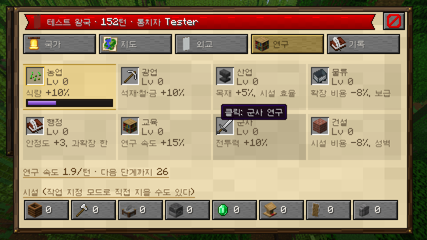
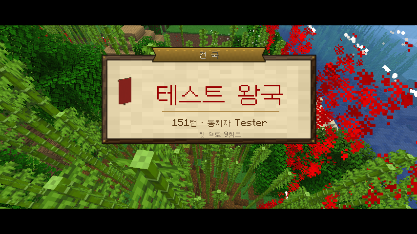

메모: 메뉴 데이터가 32,767자를 넘어 접속이 끊기는 문제가 있었다. 클라이언트·서버 메시지를 gzip 바이트 배열로 바꿔 해결했다. AI가 답을 기다리는 같은 제안을 반복해서 보내던 문제도 막았다.

## 1.7 C단계: 세계 준비 · 미리 생성 · 조물주 모드 (2026-10-17)

- **새 세계는 설정을 기다린다.** 나라를 만들기 전에 관리자(OP)가 접속하면 세계 준비 화면이 자동으로 열린다 (바닐라 클라이언트는 채팅 버튼, 콘솔은 `/gs setup <크기>`). 이미 시작된 세계는 그대로 이어지고, `/gs setup`으로 경계만 바꿀 수 있다.
- **크기 5단계**: 500(작은 섬, 나라 3) · 1000(지방, 4) · 2000(왕국, 6) · 3500(대륙, 8) · 5000(세계, 10). 고르면 스폰 중심 월드 경계, 처음 나라 수, 나라가 흩어지는 반경, 최소 나라 수가 함께 정해진다.
- **미리 생성**: Chunky가 설치돼 있으면 `chunky world/shape/center/radius/start` 명령으로 맡기고 `chunky progress` 출력을 읽어 완료를 감지한다 (GPL 코드를 링크하지 않는다). 없으면 내장 생성기가 비동기 청크 요청을 24개씩, 틱당 8ms 안에서 보낸다. 진행률·속도·남은 시간을 보스바로 모두에게 보여준다(Chunky는 자체 보스바). 서버를 껐다 켜도 이어진다.
- **조물주 모드** (기본 켬): 접속하면 관전 모드, `/gs mode adventure` 또는 나라 메뉴 오른쪽 위 버튼으로 모험 모드. 항상 피해를 받지 않고 몹이 노리지 않으며 배고프지 않다. 플레이어별 선택은 저장된다.
- 작업 지정 HUD는 보스바 개수만큼 아래로 내려가 겹치지 않는다.

실측: 500 단계(1,089청크) 내장 생성기 17초. 1000 단계(4,225청크) Chunky 1.5.3 16초(255청크/초). 2000 단계 내장 생성기 20~64청크/초(같은 PC에서 클라이언트도 돌 때 느려짐). 모험 모드에서 피해 10 + 좀비 8초 → 체력 20 그대로.

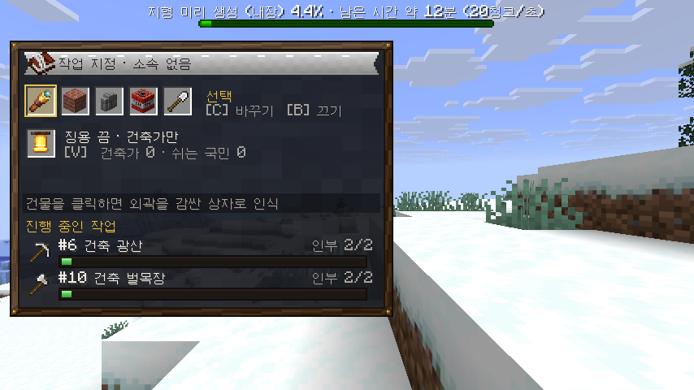

## 1.8 D단계: 전체 화면 세계 지도 (2026-10-17)

- **서버가 그린다.** 청크가 불러와지거나 내려갈 때마다 서버가 그 청크 16×16을 바닐라 지도 색으로 칠해 128×128 타일(8×8청크)에 넣는다. 높이 음영은 북쪽 이웃보다 높으면 밝게·낮으면 어둡게(uNmINeD·바닐라 지도 방식), 물은 깊이에 따라 4단계. 미리 생성이 지나간 범위는 전부 칠해진다. 타일은 `<월드>/data/grandstrategy_map/<x>_<z>.bin`(gzip)으로 저장되고 서버를 다시 켜면 불러온다. 이미 생긴 월드는 `/gs admin map rebuild`로 처음부터 다시 칠한다.
- **클라이언트는 받아서 캐시한다.** 지도를 열면 화면에 보이는 타일 중 아직 없는 것을 화면 가운데부터 한 번에 48개씩 요청하고(서버는 한 응답에 픽셀을 최대 24타일까지 보낸다), 이미 받은 타일은 1.5초마다 돌아가며 버전만 확인해 바뀐 것만 다시 받는다. 타일은 텍스처로 올려 확대·축소해도 다시 받지 않는다.
- **겹침 표시**: 나라 영토(나라색 반투명 + 국경선, 같은 주인 청크는 한 줄로 묶어 그려 축소해도 가볍다), 나라 이름(영토 무게중심, 크기에 비례), 수도(배너), 도시(종, 많이 축소하면 점), 플레이어(방향 표시), 월드 경계선.
- **조작**: `M` 또는 `/gs map` 또는 나라 메뉴 지도 탭의 "전체 지도". 끌어서 이동, 휠로 커서 위치 기준 확대·축소(1/32 ~ ×8), 버튼으로 내 위치·확대·축소·이름·국경 켜고 끄기. 처음 열면 월드 경계 전체가 들어오게 맞춘다. 아래 줄에 커서 좌표, 그 땅의 주인, 기록된 청크 수.

실측: 1000 단계(4,225청크, Chunky로 미리 생성) 전체가 지도 열고 몇 초 안에 다 채워짐. 기록된 청크 수는 청크마다 한 번만 센다(같은 청크가 다시 불러와져도 늘지 않음).

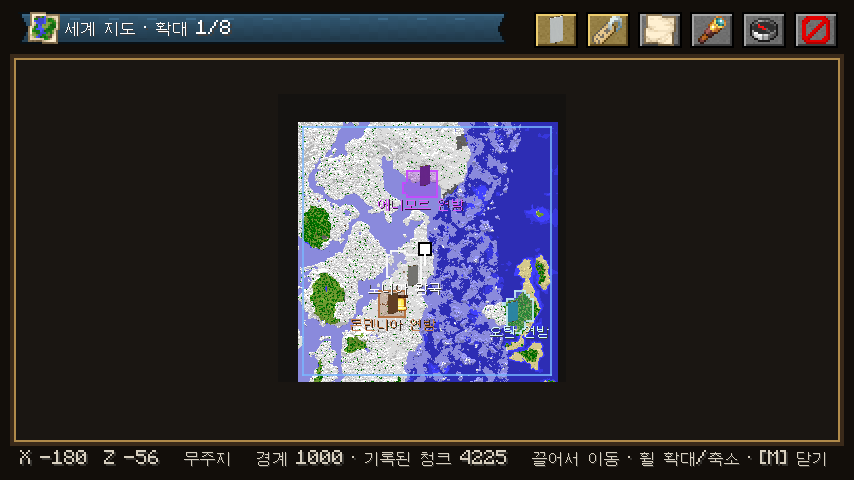

## 2. 월드박스식 핵심 시스템 (자동 요소)

| 시스템 | 동작 |
| --- | --- |
| 주민 | 나이, 성별, 직업(농부·나무꾼·광부·건축가·병사·학자…), 배고픔, 행복, 소속 가문, 성향. 태어나고, 일하고, 늙고, 죽는다 |
| 집 짓기 | 인구가 주거를 넘으면 건축가가 도시 중심에서 바깥으로 빈 터를 찾는다. 경사·물·기존 건물 검사 → 도로와 연결된 부지 선택 → 자재(목재·석재) 소모 → 건물 배치 |
| 건물 | **마인크래프트 기본 jigsaw 구조물**을 쓴다. 바닐라 마을 템플릿 풀(평원·사막·사바나·타이가·설원)을 바이옴에 맞게 고르고, 시대가 오르면 우리 템플릿 풀(석조·산업·현대·미래)로 바꾼다 |
| 도시 성장 | 마을 → 읍 → 도시 → 대도시. 단계마다 중심 건물(종 → 시청 → 궁전 등)과 도로 폭이 바뀐다 |
| 통치자 | 왕·지도자 개체가 실제로 존재한다. 성향(호전·외교·탐욕·현명)이 국가 AI 가중치가 된다. 사망하면 계승(세습·선거·찬탈)하고, 계승 분쟁은 내전으로 이어질 수 있다 |
| 가문·집단 | 귀족 가문, 종교, 길드, 정당. 충성도와 영향력을 가지며 반란·쿠데타의 주체가 된다 |
| 자유 마을 | 지금처럼 국가가 아닌 독립 세력. 개체 기반으로 바뀔 뿐이다 |

---

## 3. 넓은 스펙트럼: 고대부터 미래까지

거의 모든 요소에 시대 축을 둔다. 전부 **데이터 파일(JSON)**로 정의해서 코드 수정 없이 늘릴 수 있게 한다 (balance.json과 같은 방식, `/gs admin reload`로 반영).

| 분야 | 고대 → 미래 예시 |
| --- | --- |
| 시대 | 석기 → 청동기 → 철기 → 고전 → 중세 → 르네상스 → 산업 → 근대 → 원자력 → 정보 → 근미래 → 원미래 → 항성 |
| 무기 | 곤봉·창 → 검·활 → 화약·대포 → 소총·기관총 → 전차·항공기 → 핵분열탄 → 수소폭탄 · 화학·생물무기 → 레일건·지향성 에너지 → 나노 무기·반물질 |
| 에너지 | 근력·가축 → 장작 → 수차·풍차 → 석탄 → 석유 → 수력 → 핵분열 → 태양광·풍력 → 핵융합 → 인공 태양 → 다이슨 구조물 |
| 자원 | 식량·목재·석재 → 구리·철·금 → 석탄·석유 → 우라늄 → 희토류 → 헬륨-3 → 반물질·이그조틱 물질 |
| 사상 | 정령신앙·부족주의 → 신권·군주제 → 봉건제 → 공화주의 → 자유주의·사회주의·공산주의·파시즘 → 기술관료제 → 트랜스휴머니즘·AI 통치 |
| 정치 | 정부 형태, 법률, 선거, 쿠데타, 혁명, 검열, 계엄 |
| 집단 | 부족 → 가문 → 길드·교단 → 정당·노조 → 기업 → AI 집합체 |

대량살상무기는 게임 효과로만 존재한다 (청크 오염, 인구 감소, 국제 제재와 호감도 폭락, 핵 겨울 같은 세계 사건). 실제 제조 정보 같은 현실 지식은 다루지 않는다.

---

## 4. 국기: 마인크래프트 배너 조합

- 나라마다 배너 바탕색과 무늬 층(`BannerPatternLayers`)을 가진다. 기본값은 무작위 조합이고, 국가색과 어울리게 생성한다.
- 플레이어가 베틀에서 만든 배너를 국가 메뉴의 국기 칸에 **끌어다 놓으면** 국기가 바뀐다 (아이템의 배너 무늬 컴포넌트를 읽는다. 아이템은 돌려준다).
- 국기는 GUI 아이콘, 수도 깃발 블록, 컷신(클라이언트의 배너 깃발 모델 렌더러)에 같은 무늬로 나온다.

---

## 5. 월드 준비: 크기 5단계 + 미리 생성

메뉴(GUI)에서 고른다.

| 단계 | 크기 (블록) | 대략 청크 수 |
| --- | --- | --- |
| 1 | 500 × 500 | 1천 |
| 2 | 1000 × 1000 | 4천 |
| 3 | 2000 × 2000 | 1.6만 |
| 4 | 3500 × 3500 | 4.8만 |
| 5 | 5000 × 5000 | 9.8만 |

고르면 월드 경계를 설정하고, Chunky가 설치돼 있으면 같은 범위를 미리 생성한다 (진행률을 보스바로 표시). 미리 생성이 끝나야 지도와 시뮬레이션이 모든 땅을 안다.

---

## 6. 지도

Xaero's World Map / uNmINeD를 참고해 직접 만든다.

- 지형을 위에서 본 픽셀 지도. 블록의 지도 색 + 높이 음영(uNmINeD식), 물 깊이 표현
- 확대·축소·끌어서 이동, 좌표 표시, 웨이포인트
- 겹침 표시: 국경(국가색 반투명 채움과 테두리), 수도·도시 아이콘, 자유 마을, 전선, 군대 위치
- 미리 생성된 범위를 서버가 타일로 렌더링해서 클라이언트에 보낸다. 클라이언트는 캐시한다

---

## 7. 플레이어의 위치: 조물주 / 관전자

- 접속하면 기본으로 **관전자 모드**다. 메뉴에서 **모험 모드**로 바꿀 수 있다 (땅을 걸으며 마을을 보는 용도).
- 플레이어는 **항상 피해를 입지 않는다.** 몹도 노리지 않는다 (지금 컷신 보호 장치를 상시 적용으로 확장).
- 국가를 맡아 "통치"하거나, 아무 나라에도 속하지 않고 세계를 관찰·개입(재해, 축복, 국가 생성, 속도 조절)할 수 있다.

---

## 8. 메뉴 GUI

클라이언트 모드가 있으면 전용 화면을, 없으면 지금의 상자 메뉴를 쓴다. 디자인은 계속 마인크래프트 고유 스타일(기본 GUI 텍스처, 아이템 아이콘, 기본 글꼴)이다.

탭: 세계(크기·미리 생성·속도) / 지도 / 국가 / 국기 / 기술·시대 / 군사 / 외교 / 사상·정치 / 기록 / 관찰자 도구

---

## 8.5 건물 디자인 늘리기 (사용자 요청, 예정)

유튜브·검색으로 찾은 건물 디자인을 직접 지어 에셋(구조물 템플릿)으로 만든다. 원칙:

- 남의 스케매틱 파일을 그대로 넣지 않는다. 배포 조건이 명시된 것(CC0 등)만 출처를 적어 쓴다.
- 영상·사진은 형태와 양식만 참고하고, 블록 배치는 이 프로젝트에서 새로 만든다 (코드로 생성하거나 직접 지어 `structure` 파일로 저장).
- 시대별(석기 → 중세 → 산업 → 현대 → 미래) × 바이옴 양식으로 늘리고, 작업 지정 모드의 건물 목록에 그대로 붙는다.

## 9. 진행 순서

| 단계 | 내용 | 완료 기준 |
| --- | --- | --- |
| **A** ✅ | 개체 LOD 기반 (L0 데이터 + L1 패킷 표시) + 벤치마크 | 개체 20,000~100,000 / 플레이어 1에서 TPS 20 측정 완료. 10인은 미측정 |
| B | 월드박스식 주민 행동 + jigsaw 집 짓기 + 도시 성장 + 통치자 | AI 국가가 실제 건물을 짓고 커지는 것이 월드에서 보임 |
| C ✅ | 월드 준비 GUI (크기 5단계, Chunky 연동, 조물주 모드) | 새 월드에서 메뉴만으로 시작 가능 |
| D ✅ | 지도 | 국경·도시가 지도에 실시간 반영 |
| E | 국기(배너) + 데이터 기반 콘텐츠 틀 (시대·기술·무기·에너지·자원·사상) | JSON만 고쳐 새 무기나 시대 추가 가능 |
| F | 전쟁 고도화 (개체 군대, 전선, 보급, 대량살상무기 효과) + 정치·집단 | 전쟁이 월드와 지도에서 보이고, 정치 사건 발생 |
| 상시 | 컷신 개선 | 사용자 피드백 반영 |

A가 B~F 전부의 바닥이라 먼저 한다. 지금 MVP의 국가·외교·전쟁 로직은 버리지 않고 개체 위로 옮긴다.

---

## 10. 알려진 문제

- 개발용 클라이언트(`runClient`)가 실행 직후 글꼴을 불러올 때 절반 정도 확률로 네이티브 크래시(0xC0000005, JVM 크래시 로그 없음)가 난다. 모드 코드가 돌기 전 단계라 그래픽·오디오 드라이버 등 환경 문제로 보이지만 확정하지 못했다. 다시 실행하면 뜬다. 실제 런처 클라이언트에서도 나는지는 확인하지 않았다.
